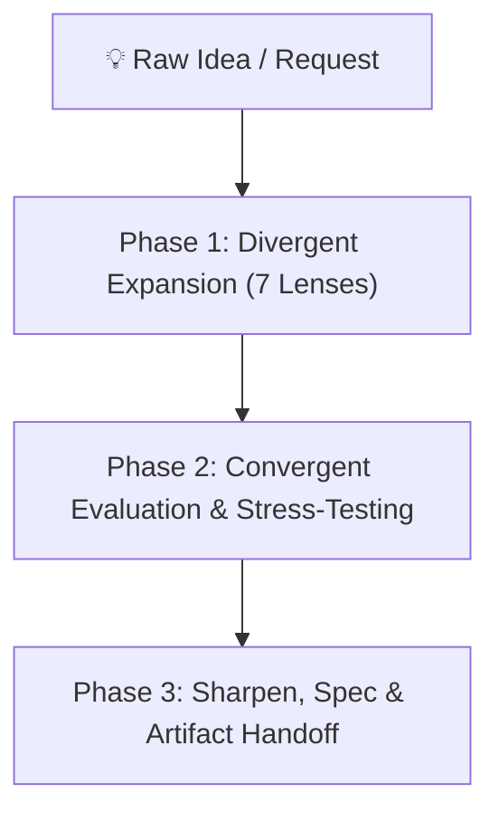

# Brainstorming Ideas Into Designs

Turn rough ideas into sharp, actionable concepts and production-grade specifications through structured collaborative dialogue and divergent/convergent thinking. Classify scope first, explore variations, stress-test assumptions, present architectural designs, and secure approval before touching production code.

**Announce at start:** *"I'm using the brainstorming skill to shape this idea before building anything."*

---

## When to Use This Skill

- User describes a new feature, project, or component to build
- User says "brainstorm", "ideate", "refine this idea", "design this", "stress-test my plan"
- Before ANY creative or building work — never jump straight to code
- Modifying existing system behavior in non-trivial ways

## The Hard Gate

> [!CAUTION]
> Before taking ANY implementation action — writing production code, scaffolding, installing dependencies, or modifying files — complete the selected path's approval. Approval of an idea does NOT approve unwritten code. Read-only codebase exploration IS encouraged.

---

## The Three Scope Paths

Before asking detailed questions, **classify the request and state it out loud**:

### 1. Spike (Feasibility Probe)
A quick feasibility question (*"is it possible to...", "can we test if..."*). Output is an answer and recommendation, not retained code.
- Present probe question in 2-3 sentences → get approval → investigate minimally → label results as throwaway.

### 2. Bounded (Scoped Existing Flow)
A well-defined modification to an existing codebase where the flow is already in place.
- Clarify key questions → present short design in chat (files, approach, tests) → **STOP and wait for explicit approval** → proceed to TDD implementation.

### 3. Architectural (New Features, Subsystems, Projects)
New projects, multi-file features, or significant structural changes.
- Follow the full 3-phase divergent/convergent process below → generate written spec in `docs/specs/YYYY-MM-DD-<topic>-design.md` → user approval → transition to `writing-plans`.

---

## The 3-Phase Ideation & Design Process



### Phase 1: Understand & Expand (Divergent)

1. **Restate as a "How Might We" Problem Statement**: Frame the core user problem crisply.
2. **Ask 3-5 Sharpening Questions**:
   - Who specifically is this for?
   - What does success look like?
   - What are the hard constraints (time, tech, resources)?
   - Why now? What was tried before?
3. **Generate 5-8 Idea Variations Using the 7 Lenses**:
   - **Inversion**: What if we did the complete opposite?
   - **Constraint Removal**: What if budget, time, or tech weren't constraints?
   - **Audience Shift**: What if this were built for a different persona?
   - **Combination**: What if we merged this with an adjacent capability?
   - **Simplification**: What is the version that is 10x simpler?
   - **10x Scale**: What would this look like at massive volume?
   - **Expert Lens**: What would domain experts find obvious that outsiders miss?
   *(See [`frameworks.md`](frameworks.md) for specialized frameworks).*

### Phase 2: Evaluate & Converge

1. **Cluster into 2-3 Distinct Directions**: Group resonant concepts into genuinely distinct architectural paths.
2. **Stress-Test Against Core Rubrics** *(See [`refinement-criteria.md`](refinement-criteria.md))*:
   - **User Value**: Painkiller vs. vitamin?
   - **Technical Feasibility**: What is the highest-risk component?
   - **Differentiation**: What makes this approach uniquely compelling?
3. **Surface Hidden Assumptions**:
   - What must be true for this to work?
   - What could fatally break this idea?
   - What are we consciously choosing to ignore for now?
4. **Be an Honest Partner**: Push back with kindness when ideas are over-engineered or weak. Reject unnecessary complexity early.

### Phase 3: Sharpen & Spec

For architectural projects, generate the specification document:

```markdown
# [Idea / Feature Name] Design Specification

## Problem Statement
[One-sentence "How Might We" framing]

## Recommended Direction
[2-3 paragraphs describing architecture, components, and data flow]

## Key Assumptions to Validate
- [ ] [Assumption 1 and validation test]
- [ ] [Assumption 2 and validation test]

## MVP Scope
- **Included**: [Explicit minimal set of capabilities]
- **NOT Doing (and Why)**:
  - [Feature A] — [Explicit trade-off rationale]
  - [Feature B] — [Deferred to v2]

## Architectural Boundaries & Interfaces
- Components, data contracts, and public APIs.
```

---

## Spec Self-Review & Approval Gate

Before presenting to the user:
1. **Placeholder Scan**: Eliminate all "TBD", "TODO", and vague descriptions.
2. **Internal Consistency**: Verify interfaces, method names, and data shapes align across sections.
3. **User Review Gate**: Present the spec location and ask:
   > *"Spec written and committed to `docs/specs/<name>.md`. Does this match your intent before we generate the implementation plan?"*
4. **Transition**: Once approved, invoke the **`writing-plans`** skill.

---

## Common Rationalizations & Red Flags

| Rationalization | Reality & Fix |
|:---|:---|
| *"This is too simple to need a design"* | Follow the selected path. Bounded takes 2 minutes in chat; skipping causes rework. |
| *"I understand this domain, so I'll start coding"* | Familiarity is not user approval. Present the plan first. |
| *"The spike worked, so I'll keep the code"* | A spike's output is an answer. Keeping it requires classifying as a new task. |
| *"I'll add everything the user might eventually want"* | YAGNI ruthlessly. The "NOT Doing" list is the most valuable part. |
