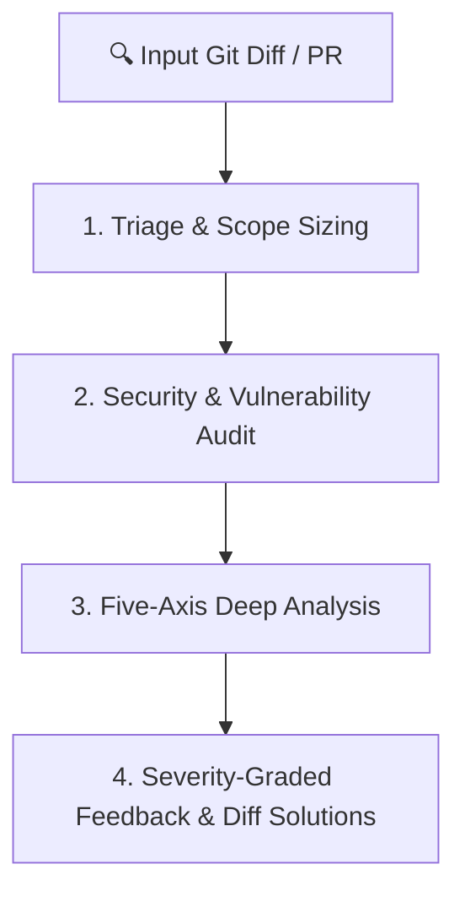

# Code Review Excellence

Transform code review into a rigorous quality gate and continuous knowledge-sharing engine. Combines automated static analysis patterns (OWASP, Semgrep, CodeQL) with multi-axis quality evaluation, structural remedies, and empathetic, actionable, severity-graded feedback.

**The approval standard:** Approve a change when it definitely improves overall code health, even if it isn't perfect. Perfect code doesn't exist — the goal is continuous improvement. Don't block a change because it isn't exactly how you would have written it. If it improves the codebase and follows the project's conventions, approve it.

---

## When to Use This Skill

- Reviewing pull requests, feature branches, or commits
- Performing pre-merge code quality, security, and performance audits
- Evaluating code written by yourself, another agent, or a human
- Refactoring existing code or reviewing bug fixes (both fix and regression tests)
- User asks to "review this PR", "review my code", "audit diff"

## Do Not Use This Skill

- Writing production feature code from scratch
- Pure design discussions without code diffs
- Simple spelling fixes or trivial single-line renames

---

## The 4-Tier Review Pipeline



### Tier 1: Triage & Change Sizing

1. **Understand Intent & Context**:
   - What is this change trying to accomplish?
   - What spec, issue, or task does it implement?
   - What is the expected behavior change?
2. **Analyze Diff Size & Sizing Guidelines**:
   - `~100 lines`: Ideal. Reviewable in one sitting.
   - `~300 lines`: Acceptable if a single logical change.
   - `> 600-1000 lines`: Flag PR for decomposition. Split before submitting.
   - **Watch file size**: A small diff that pushes a file past ~1000 total lines is an inspection signal. Decompose and extract modules first before adding more.
3. **Splitting Strategies for Large Changes**:
   - **Stack**: Submit small changes sequentially based on earlier ones.
   - **By File Group**: Separate changes for different concerns or reviewers.
   - **Horizontal**: Create shared types/stubs first, then consumers.
   - **Vertical**: Break into smaller full-stack slices.
   - **Separate refactoring from feature work**: Never mix behavior changes with large structural cleanups.

### Tier 2: Security & Vulnerability Audit

Scan the diff for critical security flaws:
- **Injection Flaws**: SQL injection, command injection, XSS, SSRF, template injection.
- **Authentication & Authorization**: IDOR, missing permission checks, broken session state.
- **Secrets & Credentials**: Hardcoded API keys, JWT secrets, database connection strings, tokens.
- **Data Privacy**: PII leakage in structured logs, unencrypted sensitive fields.
- **Supply Chain**: Unpinned dependencies, vulnerable packages (`npm audit`), untrusted sources.

### Tier 3: The Five-Axis Deep Analysis

Every review evaluates code across these five core dimensions:

#### 1. Correctness
- Does it match the spec or task requirements?
- Are edge cases handled (null, empty, boundary values)?
- Are error paths handled (not just the happy path)?
- **Review tests first**: Do tests test behavior (not implementation)? Invert a condition in the change — if tests stay green, name the missing test case!

#### 2. Readability & Simplicity
- Are names descriptive and consistent with project conventions?
- Is control flow straightforward (no nested ternaries, deep callbacks)?
- **Could this be done in fewer lines?** (1000 lines where 100 suffice is a failure).
- **Are abstractions earning their complexity?** (Don't generalize until the third use case).
- Are there dead code artifacts (`_unused`, backward-compat shims, commented-out code)?
- Is a new conditional bolted onto an unrelated flow? Push it into its own helper/policy instead.

#### 3. Architecture
- Does the change fit system design and maintain clean module boundaries?
- Are dependencies flowing in the right direction (no circular dependencies)?
- **Does this refactor reduce complexity or just relocate it?** Count concepts a reader must hold. Prefer restructuring that makes branches disappear over polishing an abstraction.
- Is feature-specific logic leaking into shared modules? Keep logic in its owning layer.
- Are type boundaries explicit? Avoid gratuitous `any`, unchecked casts, or silent fallbacks.

#### 4. Security
- Input sanitized and validated at boundaries. External data sources treated as untrusted.

#### 5. Performance
- Any N+1 query patterns?
- Any unbounded loops or unconstrained data fetching?
- Any synchronous operations blocking async loops?
- Unnecessary re-renders in UI components or missing list pagination?

### Tier 4: Severity-Graded Feedback & Structural Remedies

Always format review feedback with standardized severity tags:

| Severity Tag | Meaning | Merge Policy |
|:-------------|:--------|:-------------|
| 🔴 **`[BLOCKING]`** | Critical correctness bug, security vulnerability, data loss, breaking API change. | Must fix before merge. |
| 🟡 **`[IMPORTANT]`** | Performance bottleneck, missing edge case, lack of test coverage, significant tech debt. | Strongly recommended fix. |
| 🟢 **`[SUGGESTION]`** | Code style, readability, naming improvement, idiomatic refinement. | Author discretion. |
| ❓ **`[QUESTION]`** | Clarification on architectural intent, trade-offs, or assumptions. | Requires discussion. |

#### Structural Remedies
When flagging a structural problem, propose the concrete move — not just the problem:
- **Replace conditional chains** with a typed model or explicit dispatcher.
- **Collapse duplicate branches** into a single clearer flow.
- **Separate orchestration from business logic** so each reads on its own.
- **Move feature-specific logic** out of shared modules into the owning package.
- **Reuse canonical helpers** instead of bespoke near-duplicates.
- **Make type boundaries explicit** so downstream branching disappears.

---

## Actionable Feedback Format

Every review comment must include:
1. **File and Line Range**: Exact location of the issue.
2. **Issue Severity & Explanation**: Why this is an issue and what happens if left unfixed.
3. **Concrete Diff Solution**: Before/after code block showing the recommended fix.

```markdown
### 🔴 [BLOCKING] SQL Injection Vulnerability in User Search
- **Location**: `src/services/userService.ts#L42-L46`
- **Rationale**: User input `searchTerm` is concatenated directly into raw SQL query without parameterization.
- **Recommended Fix**:
```diff
- const query = `SELECT * FROM users WHERE name = '${searchTerm}'`;
+ const query = 'SELECT * FROM users WHERE name = $1';
+ const result = await db.query(query, [searchTerm]);
```
```

---

## Dependency & Dead Code Hygiene

### Dependency Discipline
- Before adding any dependency: check if the existing stack/stdlib solves it, check bundle size, check maintenance status, run security audit.
- **Upgrading dependencies**: One dependency per change. Read changelogs (semver can lie). Never hand-edit lockfiles.

### Dead Code Hygiene
- Identify code orphaned by refactoring (unused functions, components, constants).
- Explicitly list them and ask before deleting: `"Safe to remove these unused elements: [list]?"`

---

## Multi-Model Review Pattern

```
Model A writes the code
    │
    ▼
Model B reviews for correctness, security & architecture
    │
    ▼
Model A addresses feedback with tests
    │
    ▼
Human makes the final call
```

---

## Pre-Merge Review Checklist

```markdown
## Review: [PR/Change title]

### Context & Sizing
- [ ] Understand what this change does and why
- [ ] Change size is appropriate (~100-300 lines); refactoring separated from features

### Correctness & Tests
- [ ] Change matches requirements and handles edge cases
- [ ] Tests verify behavior; mutation test proves assertions catch regressions

### Readability & Architecture
- [ ] Clean names, straightforward flow, abstractions earn their keep
- [ ] Refactors reduce complexity rather than relocate it
- [ ] No feature logic leaked into shared modules

### Security & Performance
- [ ] No secrets, inputs validated at boundaries, queries parameterized
- [ ] No N+1 queries, unbounded operations, or memory leaks

### Verification
- [ ] All `[BLOCKING]` issues resolved
- [ ] Tests pass and production build succeeds
```

---

## Common Rationalizations & Red Flags

| Rationalization | Reality |
|:---|:---|
| *"It works, that's good enough"* | Working code that is unreadable, insecure, or architecturally tangled creates compounding debt. |
| *"We'll clean it up later"* | Later never comes. Review is the quality gate — require cleanup before merge. |
| *"The tests pass, so it's good"* | Tests are necessary but not sufficient. They don't catch architectural drift or security flaws. |
| *"The refactor makes it cleaner"* | Relocating complexity isn't reducing it. Look for the version where branches disappear. |
| *"AI code is probably fine"* | AI code needs more scrutiny, not less. It is confident and plausible even when subtly wrong. |
