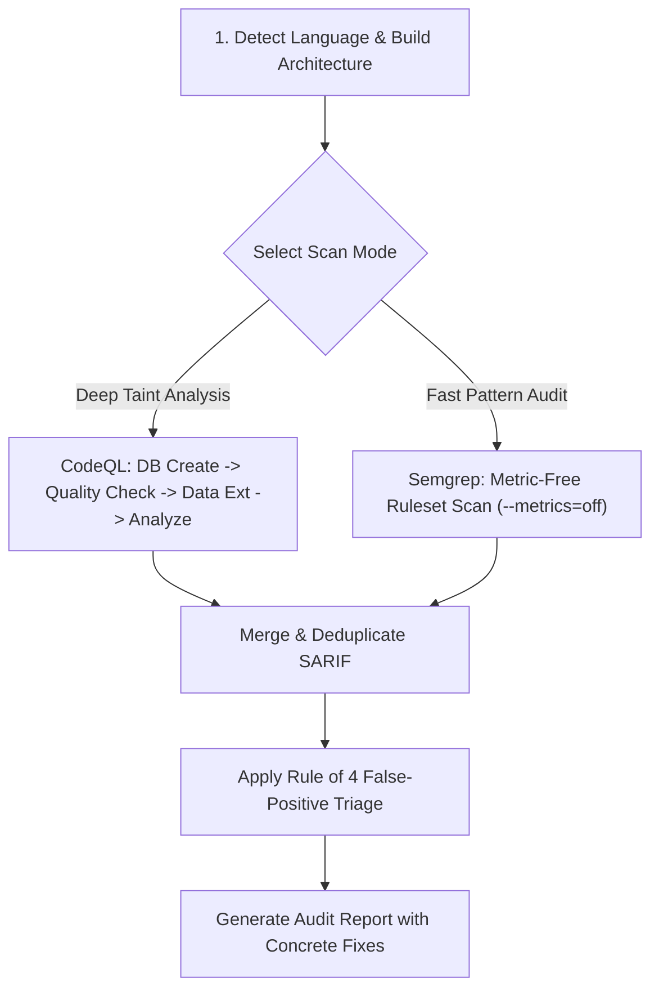

# CodeQL & Static Analysis Engineering

Deliver deep, interprocedural static security audits by combining CodeQL's advanced taint-tracking engine with Semgrep's rapid pattern matching.

---

## ⚡ Core Principles

1. **Verify Database Quality Before Claiming Green**: A successful CodeQL database build does not guarantee code extraction. Cached builds or missing build steps extract 0 lines of code while reporting success. Always gate scans with an extraction quality check.
2. **Model Proprietary APIs with Data Extensions**: Standard rules fail to detect custom wrappers around DB queries, shell calls, and request handlers. Define custom sources and sinks in YAML.
3. **Explicit Query Suites (`.qls`)**: Never invoke raw packs directly; packs use default suite filters that drop experimental or high-impact queries. Always compile explicit `.qls` suites.
4. **Offline Semgrep Standards (`--metrics=off`)**: Semgrep CLI sends telemetry and phones home with `--config auto`. All scans must append `--metrics=off` to protect source code confidentiality.
5. **Report Zero-Findings as Hypotheses, Not Triumphs**: Zero findings must document verified database extraction metrics, applied query suites, and threat model selectors.

---

## 🛠️ Operational Workflow

### 1. CodeQL Interprocedural Taint Tracking
Supported: Python, JavaScript/TypeScript, Go, Java/Kotlin, C/C++, C#, Ruby, Swift.

- **Step 1: Database Creation Ladder**:
  - For interpreted languages: create directly pointing to source root.
  - For compiled languages: test auto-detect $\rightarrow$ provide explicit build command (`make`, `mvn`, `gradle`) $\rightarrow$ fallback to `--build-mode=none` (CodeQL 2.15+).
- **Step 2: Quality Assessment**:
  - Inspect `codeql-database.yml` and run diagnostic extraction summaries.
  - Reject empty databases before spending compute on query execution.
- **Step 3: Data Extensions**:
  - For proprietary repositories, write a `.yml` model defining custom sources (e.g. `req.getSanitizedParam()`), sinks (`db.executeRawSql()`), and sanitizers (`validator.escapeHtml()`).
- **Step 4: Threat Model & Analysis**:
  - Select appropriate threat model flags: `--threat-model=remote` (default web ingress), `--threat-model=local` (CLI, env vars), or `--threat-model=database`.
  - Execute against an explicit `.qls` suite containing `security-and-quality` and `security-experimental`.

### 2. Semgrep Fast Pattern Scanning
- **Step 1: Metric-Free Invocation**:
  - Always enforce `semgrep scan --metrics=off`.
- **Step 2: High-Signal Rulesets**:
  - Official packs: `p/security-audit`, `p/owasp-top-ten`, `p/secrets`.
  - Trail of Bits pack: `https://github.com/trailofbits/semgrep-rules`.
- **Step 3: Pro Engine Cross-File Check**:
  - Verify if `semgrep --pro` is available for inter-file dataflow tracking.

### 3. Triage & Findings Delivery
Never dump raw SARIF directly onto the user. Pass every finding through the **Rule of 4**:
1. *Attacker Control*: Trace input origin from untrusted external boundary.
2. *Reachability*: Confirm taint path is uninterrupted by sanitization or validation middleware.
3. *Blast Radius*: Assess tenant or system impact.
4. *Attacker Capability*: Confirm exploitation requires no impossible external privileges.

---

## 📚 References & Resources

- Complete workflows and command scripts: [codeql-workflows.md](file:///D:/Code/Skill_Master/.agent/skills/codeql-and-static-analysis/references/codeql-workflows.md).
