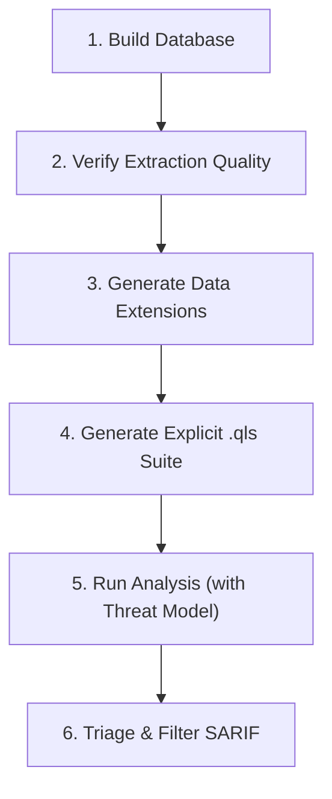

# CodeQL & Static Analysis Workflows

Complete operational guide for CodeQL interprocedural taint tracking and Semgrep pattern scanning.

---

## 1. CodeQL Analysis Lifecycle



### 1.1 Database Creation Ladder
Never assume a CodeQL database created successfully without verifying extraction.

- **Interpreted Languages** (Python, JS/TS, Ruby):
  ```bash
  codeql database create "$OUTPUT_DIR/codeql.db" \
    --language=javascript \
    --source-root="$TARGET_REPO"
  ```
- **Compiled Languages** (Go, Java/Kotlin, C/C++, C#, Swift):
  1. *Attempt 1: Auto-detection*:
     ```bash
     codeql database create "$OUTPUT_DIR/codeql.db" \
       --language=java \
       --source-root="$TARGET_REPO"
     ```
  2. *Attempt 2: Explicit build command*:
     ```bash
     codeql database create "$OUTPUT_DIR/codeql.db" \
       --language=cpp \
       --command="make -j$(nproc)" \
       --source-root="$TARGET_REPO"
     ```
  3. *Attempt 3: Build-mode none (CodeQL 2.15+)*:
     ```bash
     codeql database create "$OUTPUT_DIR/codeql.db" \
       --language=csharp \
       --build-mode=none \
       --source-root="$TARGET_REPO"
     ```

### 1.2 Database Quality Gate
A zero findings scan often results from poor database extraction. Verify:
- Confirm `codeql-database.yml` marker exists.
- Check source line coverage in database diagnostics:
  ```bash
  codeql database analyze "$OUTPUT_DIR/codeql.db" \
    --format=csv --output="$OUTPUT_DIR/diagnostics/extraction.csv" \
    codeql/<lang>-queries:Diagnostics/ExtractionSummary.ql
  ```
- If lines extracted is under 80% of repository lines of code, flag the scan as low assurance.

### 1.3 Data Extension Models
Standard CodeQL query packs miss proprietary framework wrappers (e.g., internal ORMs, custom routing middleware, internal RPC clients). Use data extensions to model:

```yaml
extensions:
  - addsTo:
      pack: codeql/javascript-all
      extensible: sourceModel
    data:
      # package, type, subtypes, name, signature, ext, output, kind, provenance
      - ["@company/router", "Router", True, "getQueryParam", "(string)", "", "ReturnValue", "remote", "manual"]
  - addsTo:
      pack: codeql/javascript-all
      extensible: sinkModel
    data:
      - ["@company/db", "QueryBuilder", True, "rawSql", "(string)", "", "Argument[0]", "sql-injection", "manual"]
```

### 1.4 Explicit Query Suite Generation (`.qls`)
Do not run raw query packs directly (`codeql database analyze db pack-name`) because default pack suites apply silent filtering that can mask real findings. Always compile an explicit `.qls`:

```yaml
# run-all.qls
- import: codeql-suites/javascript-security-and-quality.qls
  from: codeql/javascript-queries
- import: codeql-suites/javascript-security-experimental.qls
  from: codeql/javascript-queries
```

### 1.5 Threat Model Selectors
Tailor taint sources to actual system architecture:
- `--threat-model=remote`: Public web requests, HTTP headers, query params (Default).
- `--threat-model=local`: CLI arguments, environment variables, local files.
- `--threat-model=database`: Taint flowing from database records (second-order injection).

---

## 2. Semgrep Fast Static Analysis

### 2.1 Essential Rules
1. **Mandatory `--metrics=off`**: Semgrep sends telemetry by default and calls home with `--config auto`. Always append `--metrics=off` to every CLI invocation to protect source privacy.
2. **Scan Scope**: Always use `--include` or path filters to ignore tests, mock fixtures, and build artifacts.
3. **Pro Cross-File Detection**: Check if Semgrep Pro (`semgrep --pro`) is logged in; if available, leverage `--pro` for inter-file taint analysis.

### 2.2 Standard Invocations

- **Fast Security Audit (High & Medium Severity)**:
  ```bash
  semgrep scan \
    --config=p/security-audit \
    --config=p/owasp-top-ten \
    --metrics=off \
    --sarif \
    --output="$OUTPUT_DIR/semgrep-results.sarif" \
    "$TARGET_REPO"
  ```

- **Trail of Bits / Third-Party High-Signal Rulesets**:
  ```bash
  semgrep scan \
    --config=https://github.com/trailofbits/semgrep-rules \
    --metrics=off \
    --error \
    "$TARGET_REPO"
  ```

---

## 3. SARIF Merging & Unified Reporting
When running both CodeQL and Semgrep:
1. Output each tool to SARIF 2.1.0 format.
2. Filter duplicate findings by file path and line number.
3. Classify results using the standard finding schema:
   - Tool & Rule ID (e.g. `codeql:js/sql-injection`, `semgrep:typescript.react.security.audit.react-unsanitized-method`)
   - CWE / OWASP mapping
   - Source-to-sink taint path
   - Verified code snippet
   - Remediation patch
