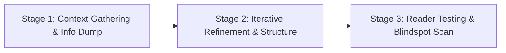

# Documentation Engineering & ADRs

Guides high-impact collaborative document creation and architectural decision tracking. Documents the *why* — context, constraints, trade-offs, and alternatives considered — not merely what code was written. Future engineers and autonomous agents rely on this context to understand and evolve the codebase.

---

## When to Use This Skill

- Writing or co-authoring technical specifications, PRDs, RFCs, or proposals
- Recording Architecture Decision Records (ADRs) for framework, database, or API choices
- Documenting why an alternative solution was rejected
- Onboarding new engineers or agents with codebase decision rationale
- User asks to "draft a doc", "write an ADR", "document this architecture"

## When NOT to Use

- Documenting self-evident code or repeating code signatures in comments
- Writing throwaway prototype notes

---

## Part 1: The 3-Stage Co-Authoring Workflow



### Stage 1: Context Gathering
1. **Clarify Meta-Context**:
   - What document type is this? (Spec, ADR, RFC, proposal)
   - Who is the primary audience? (Leadership, frontend team, external partners)
   - What is the desired impact or decision needed?
2. **Context Dump**:
   - Encourage the user to dump background, constraints, timeline, and politics without worrying about formatting.
3. **Ask 5-10 Clarifying Questions**:
   - Probe boundaries, rejected alternatives, and edge cases to eliminate ambiguity before drafting.

### Stage 2: Iterative Refinement & Structure
- Outline section headers first and confirm structure with user.
- Draft one section at a time, keeping language concise, active, and unambiguous.
- Eliminate filler words and empty marketing fluff.

### Stage 3: Fresh-Context Reader Testing
Before declaring a document finished:
- Spin up a fresh subagent (with zero conversation context) to read only the draft doc.
- Ask the reader subagent: *"What is unclear? What assumptions did you have to make? What trade-offs are missing?"*
- Address all identified blind spots inline.

---

## Part 2: Architecture Decision Records (ADRs)

ADRs capture the rationale behind irreversible or expensive technical decisions.

### ADR Lifecycle
```
PROPOSED ──→ ACCEPTED ──→ (SUPERSEDED by ADR-XXX or DEPRECATED)
```
*Never delete old ADRs.* They capture why a decision made sense at the time.

### Standard ADR Template
Save to `docs/decisions/` or `docs/adr/` matching repository conventions:

```markdown
# ADR-001: [Decision Title in Imperative Form]

## Status
Proposed | Accepted | Superseded by ADR-[XXX] | Deprecated

## Date
YYYY-MM-DD

## Context & Problem Statement
What problem are we solving? What are the key technical and organizational constraints?
- Requirement A
- Constraint B

## Decision
We will use [Technology/Pattern X] because [Primary Rationale].

## Alternatives Considered

### Option A: [Alternative Name]
- **Pros**: [Key benefits]
- **Cons**: [Key liabilities]
- **Why Rejected**: [Specific mismatch with project requirements]

### Option B: [Alternative Name]
- **Pros / Cons**: [...]
- **Why Rejected**: [...]

## Consequences & Trade-offs
- **Positive**: [What becomes easier or faster]
- **Negative / Neutral**: [What tech debt, complexity, or operational burden is accepted]
```

---

## Documentation Quality Checklist

- [ ] Explains the *why* and trade-offs, not just what was built
- [ ] Explicitly lists alternatives considered and why they were rejected
- [ ] ADRs follow repository naming and sequential numbering
- [ ] Diagram included (Mermaid) for multi-component interactions
- [ ] Tested against a fresh reader to confirm zero missing assumptions
