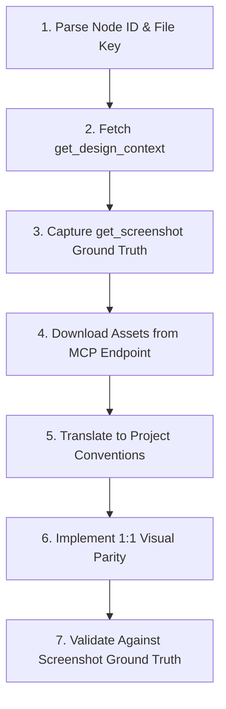

# Figma Implement Design

Translate Figma designs into production-ready application code with 1:1 visual fidelity using the Figma MCP server.

---

## ⚡ Prerequisites & Inputs

- **Figma MCP Server**: Connected and running (`figma` or `figma-desktop`).
- **Target URL**: Standard Figma design URL format:
  `https://figma.com/design/:fileKey/:fileName?node-id=1-2`
  - `:fileKey`: The unique file identifier following `/design/`.
  - `nodeId`: The query parameter `node-id` (e.g. `1-2`, `42-15` or URL-encoded `42%3A15`).
  - *(Desktop MCP)*: When using `figma-desktop`, the currently selected node in the desktop app can be used automatically without passing `fileKey`.

---

## 🛠️ The Canonical 7-Step Workflow

### Step 1: Parse Node ID & File Key
- Extract `:fileKey` and `:nodeId` from the input link.
- In URL query strings, `:` is often encoded as `%3A` or `-` (e.g. `node-id=123:456` $\rightarrow$ `nodeId: "123:456"` or `"123-456"`). Ensure exact format expected by the MCP tool.

### Step 2: Fetch Design Context
- Call `get_design_context(fileKey=":fileKey", nodeId=":nodeId")`.
- Extract:
  - Layout structures: Auto-layout directions, gaps, padding, flex wrap, constraints.
  - Typography specs: Font families, font sizes, weights, line heights, letter spacing.
  - Colors & Tokens: Hex, RGBA, and bound semantic variables/tokens.
  - Component Variants: State definitions (hover, active, focus, disabled).
- *Large Node Handling*: If the node payload is truncated or too large, call `get_metadata` first, locate the target child sub-nodes, and query them individually.

### Step 3: Capture Visual Reference (Ground Truth)
- Call `get_screenshot(fileKey=":fileKey", nodeId=":nodeId")`.
- Treat this screenshot as the absolute visual authority throughout implementation.

### Step 4: Download Required Assets
- Fetch all vector SVGs, icons, and raster images directly from the local MCP endpoint (e.g. `localhost` URLs returned in the design context).
- **Strict Asset Rules**:
  - Do NOT invent placeholder boxes or fallback URLs if a local asset endpoint is provided.
  - Do NOT install unapproved third-party icon packages when SVGs are in the Figma export.
  - Save icons and assets into the project's canonical assets directory (`public/assets/`, `src/assets/`, etc.).

### Step 5: Translate to Project Conventions
- Treat raw MCP code output as a design reference, not verbatim production code.
- Map Figma colors, radii, and spacing to existing project design tokens (Tailwind config, CSS variables, theme objects).
- Reuse existing shared UI components (buttons, badges, inputs, modal dialogs) instead of creating duplicate one-off elements.
- Adhere to the target framework's conventions (React/Next.js, Vue/Nuxt, Svelte, or native CSS).

### Step 6: Implement 1:1 Visual Parity
- Implement pixel-perfect layout alignment, matching font weights and margin rhythms.
- Implement required interactive pseudo-states (`:hover`, `:active`, `:focus-visible`, `:disabled`).
- Ensure WCAG AA compliance for contrast ratios and keyboard navigation.

### Step 7: Final Verification Checklist
Before marking completion, compare the live rendered component with the Figma screenshot:
- [ ] Layout dimensions, spacing, margins, and alignment match.
- [ ] Typography scale, font weight, line height, and letter spacing match.
- [ ] Colors and border radii match design tokens.
- [ ] Interactive states (hover, focus ring, active) function cleanly.
- [ ] Responsive breakpoints maintain intended flex/grid behavior.
- [ ] Icons and image assets render sharply at retina resolutions.
