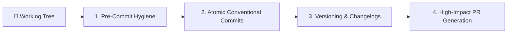

# Complete Git & PR Delivery Workflow

Git is your safety net. Treat commits as save points, branches as short-lived sandboxes, and history as documentation. Orchestrates end-to-end Git delivery from local atomic commits through Semantic Versioning and high-impact Pull Request creation.

---

## When to Use This Skill

- Preparing uncommitted changes for clean Git commits
- Formatting Conventional Commits (`feat:`, `fix:`, `refactor:`, `test:`, `docs:`, `chore:`)
- Splitting messy working trees into self-contained atomic commits
- Opening or enhancing Pull Requests with test evidence and structured summaries
- Tagging releases, choosing semantic version bumps, and authoring human changelogs
- Managing short-lived feature branches or isolated Git worktrees

## Do Not Use This Skill

- For complex git surgery like recovering lost commits via reflog or interactive rebase (use `git-advanced-workflows`)
- Reviewing code without making commits or PRs (use `code-review-excellence`)

---

## Core Delivery Principles

### 1. Trunk-Based Development
Keep `main` always deployable. Feature branches should be short-lived (merge within 1-3 days). Long-lived branches diverge and accumulate merge conflicts. Prefer deploying incomplete work behind feature flags.

```
main ──●──●──●──●──●──●──●──●──●──  (always deployable)
        ╲      ╱  ╲    ╱
         ●──●─╱    ●──╱    ← short-lived feature branches (1-3 days)
```

### 2. The Save Point Pattern
```
Work pattern:
  Implement slice → Test → Verify → Commit → Next slice
```
Commits are save points. If the next change breaks something, `git reset --hard HEAD` returns you immediately to the last known-good state without losing hours of work.

### 3. Change Sizing Discipline
- `~100 lines`: Ideal. Easy to review, safe to revert.
- `~300 lines`: Acceptable for a single logical unit.
- `> 600-1000 lines`: Too large. Split horizontally or vertically into separate PRs.
- **Separate refactoring from feature work**: Never bundle code cleanups with behavior additions.

---

## The 4-Phase Delivery Pipeline



### Phase 1: Pre-Commit Hygiene & Triage

1. **Check Working Tree & Staged Diffs**:
   ```bash
   git status
   git diff --staged
   ```
2. **Scan for Credentials & Junk**:
   - Verify no secrets, `.env` files, temporary logs, or build artifacts (`dist/`, `.next/`) are staged.
3. **Execute Pre-Commit Verification**:
   - Run linter: `npm run lint` / `flake8`
   - Run type checks: `npx tsc --noEmit`
   - Run tests: verify full green suite before committing.

### Phase 2: Atomic Commits & Conventional Standards

Stage and commit logical units independently:
- **Format**:
  ```
  <type>(<optional scope>): <imperative subject>

  <body explaining WHY and intent, not what is obvious from the diff>
  ```
- **Standard Types**:
  - `feat`: New feature or user capability
  - `fix`: Bug fix
  - `refactor`: Structural change neither fixing a bug nor adding a feature
  - `test`: Adding or correcting tests
  - `docs`: Documentation updates only
  - `chore`: Tooling, dependencies, or configuration changes

### Phase 3: Release, Semver & Human Changelogs

Commits track internal changes; **versions** are the contract with consumers.

#### Semantic Versioning (Semver)
- **MAJOR** (`v2.0.0`): Breaking API changes. Consumers must modify code to upgrade.
- **MINOR** (`v1.1.0`): Backward-compatible new functionality.
- **PATCH** (`v1.0.1`): Backward-compatible bug fixes.

#### Immutable Git Tags
```bash
git tag -a v1.4.0 -m "Release 1.4.0"
git push origin v1.4.0
```

#### Curated Human Changelog
Maintain `CHANGELOG.md` written for humans, grouped by user impact:
```markdown
## [1.4.0] - 2026-10-13
### Added
- Bulk task import via CSV file upload
### Fixed
- Timezone drift in recurring task due dates
### Deprecated
- `GET /v1/tasks/all` — use paginated `GET /v1/tasks` (removal in v2.0)
```

### Phase 4: High-Impact Pull Request Scaffolding

Provide a structured, comprehensive Pull Request description:

```markdown
## Summary of Changes
- Concise 2-3 bullet explanation of what was built and why.
- Closes/Fixes #[issue-number]

## Scope & Change Summary
- **CHANGES MADE**:
  - `src/routes/tasks.ts`: Added validation middleware to POST endpoint
  - `src/lib/validation.ts`: Added TaskCreateSchema using Zod
- **THINGS I DIDN'T TOUCH (Intentionally)**:
  - `src/routes/auth.ts`: Separate concern, left untouched
- **POTENTIAL CONCERNS / MIGRATION NOTES**:
  - Requires migration `20261013_tasks_index.sql` run prior to deploy

## Type of Change
- [ ] 🚀 New feature
- [ ] 🐛 Bug fix
- [ ] ♻️ Refactoring
- [ ] ⚡ Performance improvement
- [ ] 📝 Documentation update

## Verification & Test Evidence
- **Commands Run**: `npm test`, `npm run lint`, `npx tsc --noEmit`
- **Results**: 48/48 tests passed (100% green).

## Reviewer Checklist
- [ ] Public API contracts and interfaces are preserved or documented
- [ ] Error handling and edge cases verified
- [ ] No hardcoded secrets or credentials
```

---

## Parallel Execution with Git Worktrees

When running parallel agent tasks or reviewing separate branches without interrupting local work:

```bash
# Add worktree for parallel feature development
git worktree add ../project-feature-a feature/task-creation
git worktree add ../project-feature-b feature/user-settings

# Remove worktree when complete
git worktree remove ../project-feature-a
```

---

## Common Rationalizations & Red Flags

| Rationalization | Reality & Fix |
|:---|:---|
| *"I'll commit when the whole feature is done"* | One giant commit is impossible to review or bisect. Commit each tested slice. |
| *"The commit message doesn't matter"* | Messages are long-term documentation. Explain the *why*. |
| *"I'll write the changelog later"* | At release time, impact context is forgotten. Write changelog entries with the PR. |
| *"It's just a small fix, bump patch"* | If it alters behavior consumers relied on, it is a breaking change. |
