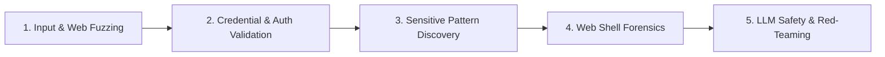

# Offensive Security Fuzzing & CTF Engineering

> [!CAUTION]
> ### STRICT LEGAL & AUTHORIZATION NOTICE
> This skill contains offensive payloads, penetration testing methodologies, and adversarial evaluation tools.
> It is **STRICTLY RESTRICTED** to:
> 1. Systems and software you personally own or host in private, isolated lab environments.
> 2. Authorized bug bounty programs operating within explicit written scope.
> 3. Authorized commercial penetration tests governed by signed Rules of Engagement (RoE).
> 4. CTF (Capture The Flag) competitions and academic vulnerability research.
>
> **Unauthorized scanning, fuzzing, or testing against third-party systems without prior written consent is illegal.**

---

## ⚡ Core Domains

### 1. Web & API Input Fuzzing
- **SQL Injection**: Test boolean differentials, error-based indicators, union payloads, and stacked time-based blind queries.
- **NoSQL Injection**: Audit JSON query parsers for parameter pollution (`$gt`, `$ne`, `$regex`, `$where`).
- **Command Injection**: Probe shell execution boundaries with chaining characters (`;`, `|`, `&&`, `||`, `$()`).
- **LDAP & XPath Injection**: Test search filters and XML query parsers with wildcard characters.

### 2. Credential & Policy Testing
- **Password Strength Auditing**: Evaluate system passwords against common dictionary subsets (500 worst, 10k most common, NCSC breach lists).
- **Username Enumeration**: Detect timing attacks and response discrepancy vulnerabilities on authentication endpoints.
- **Session Entropy Checks**: Verify session cookies and CSRF tokens have $\ge 128$ bits of CSPRNG entropy.

### 3. Sensitive Data & Secret Discovery
- Scan source code, logs, commit history, and runtime memory for accidental leakages.
- Utilize high-precision regex detectors for cloud keys (AWS AKIA, GCP service accounts), API tokens (Stripe, GitHub, Slack), and cryptographic private keys.
- Reference patterns in [payload-cheatsheet.md](file:///D:/Code/Skill_Master/.agent/skills/security-fuzzing-and-ctf/references/payload-cheatsheet.md).

### 4. Web Shell Forensics & Detection
- Identify backdoors in uploaded directories or compromised hosts.
- Analyze obfuscated signatures (`eval(base64_decode(...))`, dynamic variable functions, unquoted string concatenation).
- Verify secure file upload controls: MIME-type validation, extension allowlists, randomized filenames, and non-executable storage buckets.

### 5. LLM Safety & Adversarial Red-Teaming
- **Direct Prompt Injection**: Test boundary resilience against prompt override attempts.
- **Indirect Prompt Injection**: Verify how autonomous agents handle untrusted external content (markdown embeds, hidden HTML instructions).
- **Sensitive Data & Training Exposure**: Evaluate model refusal mechanisms when prompted for confidential keys or system prompt definitions.
- **Goal Hijack Resistance**: Ensure task-oriented agents refuse arbitrary instructions embedded in retrieved documents.

---

## 📚 Reference Materials

- Complete payload lists and regex patterns: [payload-cheatsheet.md](file:///D:/Code/Skill_Master/.agent/skills/security-fuzzing-and-ctf/references/payload-cheatsheet.md).
