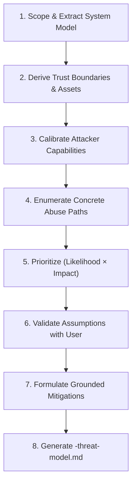

# AppSec Threat Modeling

Deliver an actionable, AppSec-grade threat model grounded directly in repository evidence. Avoid generic security checklists; anchor every trust boundary, component, and abuse path to verified code symbols, configurations, and network interfaces.

---

## ⚡ Quick Start Workflow

1. **Collect Context & Scope**:
   - Determine repository root and in-scope directories (e.g., `src/`, `api/`, `auth/`).
   - Identify runtime execution model (monolith, microservices, CLI, worker, serverless).
   - Review architectural entrypoints and deployment expectations.
2. **Consult Reference Materials**:
   - Follow the output schema in [threat-model-template.md](file:///D:/Code/Skill_Master/.agent/skills/security-threat-model/references/threat-model-template.md).
   - Check control definitions in [security-controls-and-assets.md](file:///D:/Code/Skill_Master/.agent/skills/security-threat-model/references/security-controls-and-assets.md).

---

## 🛠️ The 8-Step Threat Modeling Protocol

### 1. Scope & Extract the System Model
- Identify core components, data stores, background workers, and external third-party services.
- Distinguish production runtime entrypoints from CI/CD tooling, tests, scripts, and build tasks.
- Map in-scope locations and explicitly state what is out-of-scope (e.g., cloud provider hypervisor, third-party IdP internals).
- *Strict Rule*: Do not assert the existence of any component, flow, or security control without code evidence.

### 2. Derive Boundaries, Assets, and Entry Points
- **Trust Boundaries**: Identify boundaries where data or control passes between different trust levels (e.g., Public Internet $\rightarrow$ Reverse Proxy, API Gateway $\rightarrow$ Internal Microservice, Worker $\rightarrow$ Production Database). Note protocols (HTTPS, gRPC, mTLS), authentication, validation, and encryption.
- **Entry Points**: Catalog public REST/GraphQL endpoints, webhook receivers, file upload parsers, message consumers, admin dashboards, and CLI flags.
- **Asset Inventory**: Catalog assets that drive risk:
  - Authentication tokens, session cookies, private signing keys.
  - Customer PII and tenant databases.
  - Business logic state (e.g., financial transactions, billing records).
  - ML models, prompt templates, and vector databases.

### 3. Calibrate Attacker Capabilities
- Define realistic attacker profiles based on actual network exposure:
  - *Remote Unauthenticated Attacker*: Internet-facing HTTP requests, malicious payloads, header spoofing.
  - *Compromised Authenticated Tenant*: Legitimate user attempting horizontal/vertical privilege escalation (IDOR, BOLA).
  - *Malicious Insider / Compromised Dependency*: Code execution inside build pipeline or compromised third-party package.
- Explicitly define **non-capabilities** (e.g., "Cannot break TLS 1.3 encryption in transit", "Cannot modify cloud IAM policies directly") to prevent inflated, unrealistic risk ratings.

### 4. Enumerate Threats as Multi-Step Abuse Paths
- Map attacker objectives to specific assets and trust boundaries.
- Express each threat as a sequence of steps:
  1. *Entry*: How the attacker delivers untrusted input across a boundary.
  2. *Exploitation*: The flaw exploited (missing authz check, SSRF, prototype pollution, injection).
  3. *Impact*: Tangible blast radius (cross-tenant leak, RCE, data tampering, denial of service).
- Focus on high-signal, plausible attack paths rather than generic vulnerability lists.

### 5. Prioritize via Likelihood × Impact Matrix
- **Likelihood**:
  - *High*: Publicly reachable, easily automated, requires minimal privileges.
  - *Medium*: Requires existing authenticated user account or specific non-default configuration.
  - *Low*: Requires extreme preconditions, multi-hop pivoting, or complex race conditions.
- **Impact**:
  - *Critical/High*: Full tenant compromise, remote code execution, secret key exfiltration, irreversible data corruption.
  - *Medium*: Partial data leak, localized denial of service, rate limit exhaustion.
  - *Low*: Minor telemetry poisoning, cosmetic information leakage.
- Calculate Priority: $\text{Likelihood} \times \text{Impact}$, adjusted for existing verified controls.

### 6. Validate Context & Assumptions
- Surface critical assumptions that materially alter threat severity (e.g., "Assumed that JWT signatures are verified by upstream API gateway before reaching this microservice").
- Ask 1–3 targeted questions to resolve unknown context (deployment environment, tenancy model, ingress TLS termination).
- If operating non-interactively, state assumptions explicitly and mark affected threat ratings as provisional.

### 7. Formulate Grounded Mitigations
- Distinguish between **existing controls** (verified in code) and **recommended mitigations**.
- Anchor recommendations to specific files, functions, and middleware:
  - *Good*: "In `src/routes/tenants.ts`, enforce `req.user.tenantId === requestedTenantId` before executing DB query."
  - *Bad*: "Ensure proper authorization checks are implemented."
- Prioritize architectural defenses: input schema validation, defense-in-depth authorization filters, network egress filtering, and principle of least privilege.

### 8. Quality Check & Deliverable Generation
- Ensure all discovered public entrypoints have corresponding threat analysis.
- Verify every trust boundary is evaluated.
- Generate the final markdown report saved as `<repo-or-dir-name>-threat-model.md` following [threat-model-template.md](file:///D:/Code/Skill_Master/.agent/skills/security-threat-model/references/threat-model-template.md).
