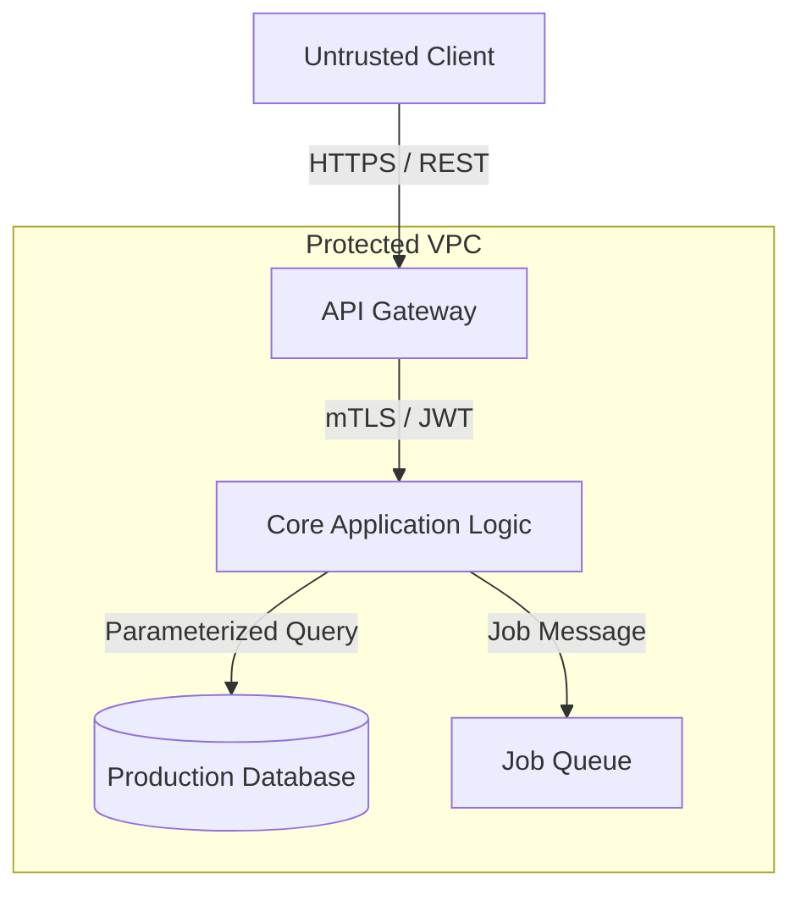

# AppSec Threat Model Output Template

Use this template to generate repo-grounded threat models. Every architectural claim must cite an evidence anchor in the codebase.

---

## Output Contract & Structure

```markdown
# Threat Model: <Repository or Directory Name>

## Executive Summary
[One concise paragraph highlighting the core system architecture, primary trust boundaries, and highest-priority security risks.]

## Scope & Assumptions
- **In-Scope Paths**: `src/`, `api/`, `auth/`
- **Out-of-Scope**: Third-party OAuth provider internals, physical hosting infrastructure
- **Key Assumptions**:
  - Service runs behind an edge reverse proxy terminating TLS.
  - Workers run in an isolated VPC with restricted outbound egress.

## System Model & Trust Boundaries
- **Internet $\rightarrow$ API Gateway**: Public untrusted traffic, TLS 1.3, rate-limited, token validation.
- **API Gateway $\rightarrow$ Service Microservices**: Authenticated internal gRPC / mTLS calls.
- **Service $\rightarrow$ Database**: Parameterized queries via ORM, encrypted at rest, access controlled via IAM.

### Architecture Diagram


## Assets & Security Objectives
| Asset | Description | Objectives (C / I / A) |
|---|---|---|
| User Credentials / Tokens | Passwords, session cookies, OAuth refresh tokens | Confidentiality, Integrity |
| Customer PII | User profile data, contact details, billing history | Confidentiality, Compliance |
| Order / Transaction State | Financial transaction ledger, cart items | Integrity, Availability |

## Attacker Model
- **Remote Unauthenticated Attacker**: Can send arbitrary HTTP requests, forged headers, and malformed JSON payloads. Cannot access internal network or DB directly.
- **Compromised Authenticated Tenant**: Legitimate user attempting horizontal privilege escalation (IDOR) to access other tenants' data.

## Top Abuse Paths
1. **Tenant Data Exfiltration via IDOR**:
   - Step 1: Attacker registers standard tenant account.
   - Step 2: Attacker observes predictable UUID or sequential ID in `/api/orders/:id`.
   - Step 3: Attacker cycles IDs without tenancy ownership validation.
   - Impact: Cross-tenant data exposure.

## Threat Model Register
| Threat ID | Threat Source | Prerequisites | Threat Action | Impact | Existing Controls | Recommended Mitigations | Likelihood | Impact | Priority |
|---|---|---|---|---|---|---|---|---|---|
| **TM-001** | Remote Client | Valid session | Enumerate order IDs without tenant check | Data leak | Route requires auth | Enforce `tenant_id` filter in DB query | Medium | High | **High** |
| **TM-002** | External Webhook | Public URL | SSRF via unvalidated webhook destination | Internal port scan | URL parser check | Pin DNS resolution & reject private IP ranges | Low | High | **Medium** |

## Focus Paths for Security Review
| Path | Reason for Focused Review | Related Threats |
|---|---|---|
| `src/routes/orders.ts` | Verify tenant isolation on all dynamic route queries | TM-001 |
| `src/services/webhook.ts` | Verify SSRF mitigations, DNS rebinding defenses, and IP allowlists | TM-002 |
```
