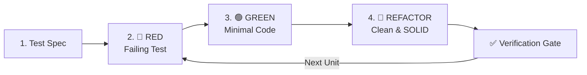

# Test-Driven Development (TDD) Master

Execute software development with strict RED-GREEN-REFACTOR discipline. TDD treats tests as living specifications and design drivers, ensuring that every line of production code is justified by a failing test.

---

## The Iron Law of TDD

> [!IMPORTANT]
> **No production code is written without a failing test first.**
> If code was written before its test, discard or stash the code, write the failing test, verify the failure, and then reimplement.

---

## When to Use This Skill

- Implementing new features or domain logic
- Fixing bugs (write a reproducing regression test first)
- Refactoring complex systems under safety nets
- User says "TDD", "test-first", "red-green-refactor"
- When high reliability and regression prevention are required

## Do Not Use This Skill

- Pure UI styling adjustments or static content tweaks
- Exploratory spikes where architecture is completely unknown (use `brainstorming-ideas` first)
- When writing documentation or configuration files

---

## The 4-Phase TDD Cycle

### Phase 1: Test Specification & Boundaries
1. **Analyze Requirements**: Identify acceptance criteria, happy paths, edge cases, and error states.
2. **Choose Testing School**:
   - **Chicago School (Classic/State-based)**: Test through public API, observe real state changes, minimize mocks. Preferred for domain models, algorithms, and core business logic.
   - **London School (Mockist/Outside-In)**: Isolate unit with test doubles, verify interactions and collaborator contracts. Preferred for coordinators, service boundaries, and external adapters.
3. **Define Interfaces**: Establish clean method signatures and return types before test writing.

### Phase 2: 🔴 RED — Write Failing Test
1. **Write ONE Atomic Test**: Target a single behavior or edge case.
2. **Run the Test**: Execute the test runner (e.g. `npm test`, `pytest`, `cargo test`, `go test`).
3. **Verify Meaningful Failure**:
   - Confirm the test **fails** as expected.
   - Verify the failure reason is missing logic or incorrect assertion — NOT a syntax error, bad import, or broken test setup.
   - *Gate*: Never proceed if the test passes accidentally.

### Phase 3: 🟢 GREEN — Make It Pass
1. **Implement Minimal Code**: Write only the simplest code necessary to make the failing test turn green.
2. **Resist Premature Optimization**: Do not add speculative features, extra parameters, or future logic.
3. **Run Suite**: Confirm the new test passes and all existing tests remain green.

### Phase 4: 🔵 REFACTOR — Improve Without Breaking
1. **Eliminate Duplication**: Apply DRY to implementation and fixtures.
2. **Improve Design & Readability**: Apply SOLID principles, extract clear helper methods, clarify variable names.
3. **Keep Tests Green**: Run tests after every refactoring step. Tests must never fail during refactoring.

---

## Configuration & Quality Gates

### Coverage Thresholds
- **Line Coverage**: ≥ 80% minimum
- **Branch Coverage**: ≥ 75% minimum
- **Critical Path / Financial / Auth Logic**: 100% required

### Refactoring Triggers
- Cyclomatic complexity > 10
- Function length > 25 lines
- Class length > 200 lines
- Duplicated logic blocks > 3 lines

---

## TDD Anti-Patterns to Prevent

| Anti-Pattern | Why It Fails | Correction |
|:-------------|:-------------|:-----------|
| **Test-After Coding** | Tests end up testing implementation rather than behavior; edge cases missed. | Delete/stash implementation and write the test first. |
| **Pass-First Test** | Test asserts nothing or has flawed assertions (false positive). | Verify that the test fails with an explicit assertion failure before implementing. |
| **Monolithic Test** | Testing 5 behaviors in 1 test method; difficult to diagnose failures. | Break into granular, single-assertion test cases. |
| **Over-Mocking** | Mocking domain classes instead of external I/O boundaries; tests pass while code is broken. | Use real domain objects; mock only external network, disk, or external dependencies. |
| **Skipping Refactor** | Code quality degrades rapidly into technical debt. | Treat refactoring as a mandatory phase of every cycle. |

---

## Verification & Subagent Delegation

When operating across large codebases or delegating to subagents:
- **Test Generation**: Delegate to `unit-testing-test-generate` for comprehensive edge cases.
- **Review**: Delegate to `code-review-excellence` to verify test isolation and coverage metrics.
- **Execution Proof**: Use `verifying-before-completion` before declaring the cycle finished.
