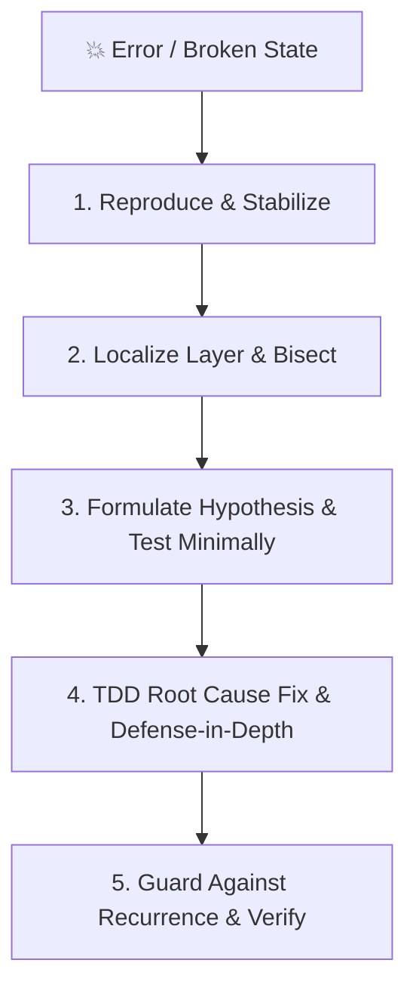

# Troubleshooting & Error Recovery

Diagnose and fix any application issue systematically by finding the true root cause first, then applying resilient error-handling and defense-in-depth patterns so the failure cannot recur. Guessing wastes time and introduces regressions.

## The Iron Law of Troubleshooting

```
NO FIXES WITHOUT ROOT CAUSE INVESTIGATION FIRST.
NO COMPLETION CLAIMS WITHOUT FRESH VERIFICATION EVIDENCE.
```

Symptom fixes are failures. If you have not completed Phase 1, do not propose or apply a code fix.

---

## When to Use This Skill

- Tests fail after a code change or build breaks
- Runtime behavior doesn't match expectations or a bug report arrives
- Investigating intermittent bugs, timing issues, race conditions, or memory leaks
- Designing retry, timeout, fallback, circuit-breaker, or fault-tolerant API logic
- Replacing vague or swallowed errors with structured, actionable diagnostics

---

## The Stop-the-Line Rule

When anything unexpected breaks:
1. **STOP** adding features or making speculative changes.
2. **PRESERVE** evidence (error traces, logs, reproduction steps, core dumps).
3. **DIAGNOSE** using the systematic triage checklist.
4. **FIX** the root cause at its source.
5. **GUARD** against recurrence with an automated regression test.
6. **RESUME** only after the full verification suite passes cleanly.

*Errors compound.* Pushing past a failing test makes every subsequent step harder to diagnose.

---

## The Systematic Triage & Troubleshooting Workflow



### Phase 1: Reproduce & Stabilize

Make the failure happen reliably. If you cannot reproduce it, you cannot fix it with confidence.

```
Can you reproduce on demand?
├── YES → Proceed to Phase 2 (Localize)
└── NO
    ├── Timing-dependent? → Add timestamps, widen race windows (concurrency load), condition-based polling
    ├── Environment-dependent? → Compare runtime versions, env vars, clean DB vs populated DB
    ├── State-dependent? → Check test pollution, leaked global variables, singletons, or caches
    └── Random? → Add defensive structured logging at suspected boundaries and monitor
```

### Phase 2: Localize Layer & Bisect

Narrow down **WHERE** the failure happens:
- **UI/Frontend**: Check console, DOM state, network tab payloads.
- **API/Backend**: Check server logs, request/response headers, middleware.
- **Database**: Check queries, schema indexes, migration status, connection pool.
- **Tooling/Build**: Check bundler config, dependency lockfiles, path resolution.

#### Regression Bisection
When code worked previously and recently broke, use Git bisect:
```bash
git bisect start
git bisect bad HEAD
git bisect good <known-working-commit>
git bisect run npm test -- --grep "failing-test-name"
```

### Phase 3: Formulate Hypothesis & Test Minimally

1. **State a Single Hypothesis**: Write down:
   > *"I think `[root cause]` happens because `[mechanism]` at `[file:line]`."*
2. **Test Minimally**: Change or instrument **one variable at a time**. Never bundle speculative edits.
3. **Trace Backward to Original Trigger**:
   - Do not patch where the crash surfaces if bad data originated higher up the call chain.
   - Trace bad inputs back to the system boundary where they first entered.

### Phase 4: Root Cause vs Symptom Fix

Always fix the underlying cause, not the visual symptom:

| Failure | Symptom Fix (Bad ❌) | Root Cause Fix (Good ✅) |
|:--------|:---------------------|:-------------------------|
| Duplicate user items in UI | `[...new Set(users)]` in UI component | Fix API SQL query `JOIN` or add `DISTINCT` in database layer |
| `TypeError: Cannot read property 'id' of undefined` | Optional chaining `user?.id ?? ""` | Validate entity presence at data repository boundary or return `404` |
| Flaky async test timeout | Add `sleep(5000)` | Replace arbitrary delay with condition-based polling |

### Phase 5: Guard Against Recurrence & Defense-in-Depth

1. **Write a Failing Regression Test First**: Replicate the exact bug in an automated test. Watch it fail for the predicted reason.
2. **Implement Root-Cause Fix**: Apply the minimal clean fix.
3. **Add Defense-in-Depth Validation**:
   - Validate inputs at system boundaries (Fail Fast).
   - Wrap internal errors preserving cause chains (`from e` in Python, `cause` in JS/TS).
   - Clean up resources with `try-finally` / `using` / `defer`.
4. **The 3-Strike Architecture Rule**: If 3 consecutive fix attempts fail, **STOP**. Do not make a 4th blind attempt. Step back and re-evaluate the architecture with the user.

---

## Error Handling Architectural Best Practices

```python
# Canonical resilient error handling pattern
def process_order(order_id: str) -> Order:
    """Process order with fail-fast boundary validation and wrapped cause chains."""
    # 1. Fail fast: validate input at boundary
    if not order_id:
        raise ValidationError("Order ID is required")

    # 2. Domain lookup
    order = db.get_order(order_id)
    if not order:
        raise NotFoundError("Order", order_id)

    # 3. Isolate external dependency with context
    try:
        payment_result = payment_service.charge(order.total)
    except PaymentServiceError as e:
        logger.error(f"Payment failed for order {order_id}: {e}")
        raise ExternalServiceError(
            "Payment processing failed",
            service="payment_service",
            details={"order_id": order_id, "amount": order.total}
        ) from e

    order.status = "completed"
    order.payment_id = payment_result.id
    db.save(order)
    return order
```

---

## Common Pitfalls & Red Flags

| Pitfall | Reality & Fix |
|:--------|:--------------|
| **Catching Too Broadly** (`except Exception:` deep in logic) | Masks bugs and signals. Catch specific domain errors. |
| **Empty Catch Blocks** (`catch (e) {}`) | Silently swallows failures and corrupts state. Log or rethrow. |
| **Log-and-Rethrow Everywhere** | Spams logs 5x. Wrap and rethrow down the stack; log once at the outer boundary. |
| **"Let me just try changing X real quick"** | Guessing wastes time. Complete Phase 1 and formulate a hypothesis first. |
| **"It works on my machine"** | Isolate environment variables, Node/Python runtimes, and clean database state. |

---

## Resources & Diagnostic Scripts

- Consult [`resources/error-handling-details.md`](resources/error-handling-details.md) for retry with backoff, circuit-breaker, and async patterns.
- Consult [`resources/root-cause-tracing.md`](resources/root-cause-tracing.md) for backward call-stack tracing.
- Consult [`resources/defense-in-depth.md`](resources/defense-in-depth.md) for 4-layer validation patterns.
