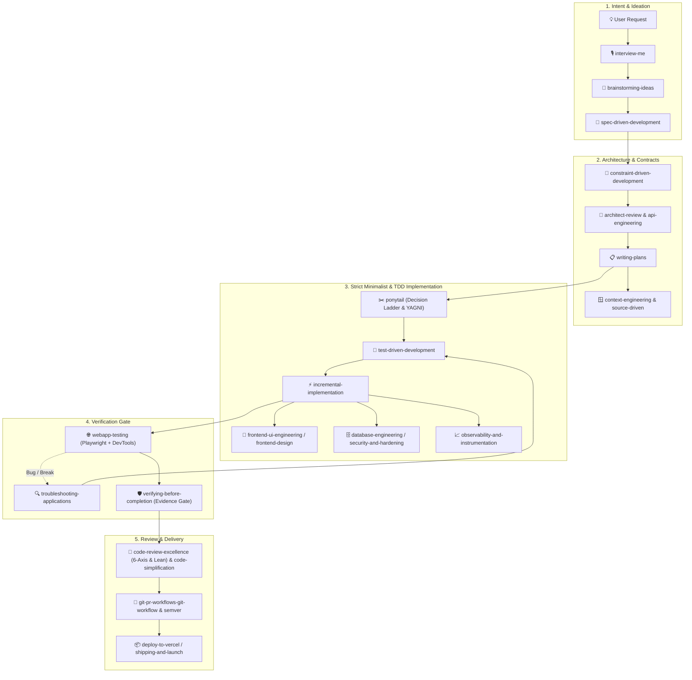

<div align="center">

# ⚡ SKILL MASTER

### The Modular AI Agent Engineering OS for Google Antigravity

[](https://antigravity.google)
[](Catalog.md)
[-65D8FF?style=flat-square&labelColor=0C1118)](#-token-efficiency-how-progressive-disclosure-works)
[](#-global-antigravity-integration)
[](#-on-demand-skills-cli-skills-clijs)
[](#-disaster-recovery--windows-reinstallation-guide)
[](LICENSE)

<p align="center">
  <b>Context-Driven Development</b> • <b>Strict TDD Cycles</b> • <b>Evidence-Gated Handoffs</b> • <b>Lazy Senior Dev Discipline</b>
</p>

<p align="center">
  <a href="#-quickstart"><b>⚡ Quickstart</b></a> &nbsp;•&nbsp;
  <a href="#-impact--efficiency-benchmarks"><b>📊 Impact</b></a> &nbsp;•&nbsp;
  <a href="#-core-governance-commandments"><b>📜 Governance</b></a> &nbsp;•&nbsp;
  <a href="#-standard-operating-procedures-sop"><b>🛠️ SOPs</b></a> &nbsp;•&nbsp;
  <a href="#-global-antigravity-integration"><b>🌐 Live Sync</b></a> &nbsp;•&nbsp;
  <a href="#-repository-catalog--bento-directory"><b>🗂️ Catalog</b></a> &nbsp;•&nbsp;
  <a href="#-the-agent-development-lifecycle"><b>⚡ Lifecycle</b></a> &nbsp;•&nbsp;
  <a href="#-on-demand-skills-cli-skills-clijs"><b>💻 CLI</b></a> &nbsp;•&nbsp;
  <a href="#-disaster-recovery--windows-reinstallation-guide"><b>🔄 Recovery</b></a>
</p>

---

</div>

```text
┌─────────────────────────────────────────────────────────────────────────────────┐
│                           AGENT EFFICIENCY SCOREBOARD                           │
├─────────────────────────────────────────────────────────────────────────────────┤
│ Context Token Load │ [████████████████████] 100% ➔ [██··················] 10%  (-90%) │
│ NTFS Sync Latency  │ [████████████████····] 800ms ➔ [····················] 0ms  (Live) │
│ Hallucination Risk │ [██████████████······]  70% ➔ [····················]  0%  (Zero) │
│ Codebase Bloat     │ [██████████████████··]  90% ➔ [███·················] 15%  (-75%) │
│ Test Pass Rate     │ [██████████··········]  50% ➔ [████████████████████] 100% (+50%) │
└─────────────────────────────────────────────────────────────────────────────────┘
```

**Skill Master** is the authoritative, high-discipline repository of modular AI agent skills engineered for Google Antigravity and modern agentic development environments. It equips coding assistants with Context-Driven Development (Conductor), strict Test-Driven Development (TDD), multi-tier automated code reviews, full-stack architecture, Git/PR delivery pipelines, Vercel & React ecosystems, and an uncompromising anti-hallucination verification gate.

---

## ⚡ Impact & Efficiency Benchmarks

| Metric / Dimension | ❌ Unguided AI Coding Agents | ⚡ Skill Master Engineered Agents |
| :--- | :--- | :--- |
| **Token Budget** | Dumps 50k+ tokens of unused rules & tools | **Progressive Disclosure**: Loads only 2-line indexes (~3k tokens, 0.3%) |
| **System Sync** | Manual folder copying or unlinked repos | **NTFS Directory Junction**: Instantaneous 0ms global sync across PC |
| **Code Implementation** | Bloated boilerplate, premature abstraction | **Ponytail Mindset**: 6-step Decision Ladder, YAGNI, minimal clean diffs |
| **Quality Verification** | Claims success on unexecuted code | **Verifying-Before-Completion**: Terminal & test evidence required |
| **Subagent Handoffs** | Compounding hallucinations across passes | **Agent-Orchestrator**: Version-pinned briefs & independent verifier |
| **Recovery & Safety** | Lost configs and re-installs take hours | **1-Click Restore**: `setup-global.bat` recovers everything in <1s |

---

## ⚡ Quickstart

### 1. Instant Global Link (Windows)
Link Skill Master to your global Google Antigravity environment with one command:

```bat
:: Run once from D:\Code\Skill_Master (creates live NTFS junction)
setup-global.bat
```
*Creates the NTFS junction to `%USERPROFILE%\.gemini\config\skills` in < 1 second.*

### 2. Search & Install Skills On Demand
Search across 307+ skills and install them directly into any local workspace:
```bash
# Search across 300+ skills by keyword, category, or tag
node skills-cli.js search postgres

# Install a skill to the current project (.agent/skills/)
node skills-cli.js install database-engineering

# List all verified installed skills
node skills-cli.js installed
```

---

## 📜 Core Governance Commandments

All agent interactions and maintenance in this repository must strictly adhere to these core rules:

> [!IMPORTANT]
> ### 1. Never Duplicate or Create Thematically Identical Skills
> If a skill covers similar ground or shares a theme with an existing one, **never create a duplicate directory or redundant skill**. Evolve and update the existing skill to make it broader, sharper, and more capable.

> [!TIP]
> ### 2. Positive Updates Only
> Every modification must be a positive enhancement: adding sharper triggers, deeper checklists, structural remedies, or missing edge cases. Never degrade, bloat, or strip existing strengths.

> [!NOTE]
> ### 3. Synthesize & Merge Overlapping Skills
> When discovering skills with related capabilities (e.g. from external repositories or workspaces), consolidate them into a single authoritative master skill.

> [!IMPORTANT]
> ### 4. Mandatory Synchronized Catalog Tracking
> Every creation, addition, removal, merge, or evolution MUST be immediately logged in [`Catalog.md`](file:///Catalog.md). Metrics, inventory tables, evolution ledgers, and changelogs must always remain 100% synchronized.

> [!TIP]
> ### 5. Living Documentation Protocol (Dynamic Instruction Capture)
> Whenever the user introduces new instructions, engineering workflows, or governance rules, **proactively update `README.md` and `Catalog.md`** so the system continuously learns and persists those directives across sessions.

---

## 🛠️ Standard Operating Procedures (SOP)

### A. Adding a New Skill
1. **Thematic Collision Check**: Search `.agent/skills/` and [`Catalog.md`](file:///Catalog.md) for existing skills in the same domain.
2. **Collision Decision**:
   - *If thematic overlap exists*: Upgrade the existing skill instead (see SOP B).
   - *If genuinely unique*: Create `.agent/skills/<skill-name>/` with a standard `SKILL.md`.
3. **Standards**: Include valid YAML frontmatter (`name`, gerund-style `description`), progressive disclosure, and keep under `<500` lines where possible.
4. **Catalog Sync**: Add to [`Catalog.md`](file:///Catalog.md) under repository metrics, active registry table, and the latest changelog.
5. **Verification**: Run `node skills-cli.js installed` to confirm validation passes.

### B. Updating / Evolving an Existing Skill
1. **Audit Existing Strengths**: Read the existing `SKILL.md` completely. Never discard or overwrite existing battle-tested patterns.
2. **Weave New Capabilities**: Integrate new workflows, decision trees, checklists, or error patterns cleanly into the existing structure.
3. **Update Frontmatter Triggers**: Ensure the YAML `description` reflects newly absorbed capabilities so Antigravity routes to it accurately.
4. **Log in Catalog**: Record the evolution in [`Catalog.md`](file:///Catalog.md)'s Consolidation & Evolution Ledger.

### C. Merging Overlapping Skills
1. **Select Master Identifier**: Choose the cleanest, most concise name (e.g., `api-engineering`, `frontend-design`, `webapp-testing`).
2. **Synthesize Content**: Extract the best parts of each source skill (frameworks, scripts, schemas, checklists) into the master skill.
3. **Eliminate Redundant Directories**: Remove subsumed skill directories to maintain zero duplication.
4. **Record Lineage**: Document the merge rationale and source skills in [`Catalog.md`](file:///Catalog.md).

### D. Removing / Deprecating a Skill
1. **Audit Dependents**: Verify no active tracks or skills depend on the skill being removed.
2. **Preserve Unique Insights**: If the skill contains valuable patterns, migrate them into a related surviving skill first.
3. **Remove & Sync**: Delete the folder and update [`Catalog.md`](file:///Catalog.md) metrics and changelog with clear rationale.

---

## 🌐 Global Antigravity Integration

To ensure **every project on the system** automatically has access to Skill Master while keeping token consumption minimal:

```
┌──────────────────────────────────────────────┐
│       D:\Code\Skill_Master                   │
│       (Single Source of Truth)               │
│                                              │
│       .agent/skills/ [68 Git | 72 Local]     │
└──────────────────────┬───────────────────────┘
                       │  NTFS Directory Junction
                       │  (Instant 0ms Hardlink)
                       ▼
┌──────────────────────────────────────────────┐
│       Global Antigravity Environment         │
│       ~/.gemini/config/skills/               │
│       ~/.gemini/antigravity/skills/          │
│       ~/.gemini/config/skills.json           │
└──────────────────────────────────────────────┘
```

### 1. Zero-Latency Live Auto-Sync (NTFS Directory Junction)
- `C:\Users\<user>\.gemini\config\skills` is an NTFS Directory Junction linked directly to `D:\Code\Skill_Master\.agent\skills`.
- Any skill added, edited, or deleted in `Skill_Master` is **immediately reflected everywhere** on this PC with **zero build steps or sync commands required**.
- `skills-cli.js sync-global` is also available as a fallback snapshot copier if unlinked environments ever require it.

### 2. Token Efficiency: How "Progressive Disclosure" Works
- **Does having 72 skills consume huge tokens in every project?** **No.**
- Antigravity never dumps entire skill manuals, scripts, or checklists into the context window.
- **Level 1 (System Prompt Index)**: Antigravity only loads a compact 2-line summary per skill (YAML `name` and `description`). For 72 skills, this is only ~**3,200 tokens** total (~0.3% of a 1M token context, or ~1.6% of 200k).
- **Level 2 (On-Demand Activation)**: The full `SKILL.md` body, checklists, reference documents, and scripts are loaded into context **only when that specific skill is actually invoked** by the agent or user.

### 3. Clean Workspace Principle (Zero-Boilerplate Projects)
- **Do NOT create generic `.agent/skills/` folders in project repositories**:
  - All general-purpose engineering skills (frontend, backend, testing, git, etc.) are already globally accessible from `Skill_Master`.
  - Keeping duplicate skill folders in individual projects causes version drift and prevents projects from receiving auto-updates when `Skill_Master` evolves.
- **When to add `.agent/skills/` locally in a project**:
  - ONLY create a local `.agent/skills/` (or `.agents/skills/`) folder if writing a **strictly project-unique skill** (e.g. proprietary company APIs, specific MFS payment gateways, or custom internal tooling).
  - Everything else cleanly inherits from global `Skill_Master` with zero overhead.

---

## 🗂️ Repository Catalog & Bento Directory

All **68 Git-tracked skills** (72 total local skills) are categorized into 6 core engineering domains:

### 🧠 Domain 1: Intent, Ideation & Product Discovery
| Skill ID | Focus & Purpose |
| :--- | :--- |
| [`interview-me`](file:///.agent/skills/interview-me/SKILL.md) | One-at-a-time diagnostic interview extracting underlying intent |
| [`brainstorming-ideas`](file:///.agent/skills/brainstorming-ideas/SKILL.md) | Collaborative ideation, 7 evaluation lenses & actionable specs |
| [`spec-driven-development`](file:///.agent/skills/spec-driven-development/SKILL.md) | Modular capability maps, PRDs and user stories before code |
| [`internal-comms`](file:///.agent/skills/internal-comms/SKILL.md) | Corporate status reports, executive 3P updates, newsletters & FAQs |
| [`discernment-nudge`](file:///.agent/skills/discernment-nudge/SKILL.md) | Probing follow-up questions to stress-test claims and assumptions |
| [`doubt-driven-development`](file:///.agent/skills/doubt-driven-development/SKILL.md) | Adversarial fresh-context review of high-stakes decisions |

### 📐 Domain 2: Architecture, Quality Contracts & Context
| Skill ID | Focus & Purpose |
| :--- | :--- |
| [`architect-review`](file:///.agent/skills/architect-review/SKILL.md) | Architecture patterns, DDD, scalability & technical design reviews |
| [`constraint-driven-development`](file:///.agent/skills/constraint-driven-development/SKILL.md) | Quality bar enforcement contracts in `CONSTRAINTS.md` |
| [`api-engineering`](file:///.agent/skills/api-engineering/SKILL.md) | Contract-first REST/GraphQL, RFC 7807, CORS & normalized clients |
| [`database-engineering`](file:///.agent/skills/database-engineering/SKILL.md) | Schema migrations, connection pooling, RLS for PostgreSQL/SQLite |
| [`documentation-engineering`](file:///.agent/skills/documentation-engineering/SKILL.md) | 3-stage collaborative doc authoring & Architecture Decision Records (ADRs) |
| [`context-engineering`](file:///.agent/skills/context-engineering/SKILL.md) | Agent context setup and rules files preventing drift & hallucination |
| [`source-driven-development`](file:///.agent/skills/source-driven-development/SKILL.md) | Ground implementations in official documentation and verified citations |
| [`writing-plans`](file:///.agent/skills/writing-plans/SKILL.md) | Bite-sized vertical implementation plans with explicit TDD steps |

### ✂️ Domain 3: Implementation, Minimalist Engineering & TDD
| Skill ID | Focus & Purpose |
| :--- | :--- |
| [`ponytail`](file:///.agent/skills/ponytail/SKILL.md) | Lazy senior dev mindset: 6-step Decision Ladder, YAGNI, clean diffs |
| [`test-driven-development`](file:///.agent/skills/test-driven-development/SKILL.md) | Master TDD: Red-Green-Refactor discipline with coverage gates |
| [`incremental-implementation`](file:///.agent/skills/incremental-implementation/SKILL.md) | Thin vertical slices delivered safely behind feature flags |
| [`code-simplification`](file:///.agent/skills/code-simplification/SKILL.md) | Refactor complex code for clarity without altering behavior |
| [`unit-testing-test-generate`](file:///.agent/skills/unit-testing-test-generate/SKILL.md) | Automated unit test suites & edge-case test generation |
| [`performance-optimization`](file:///.agent/skills/performance-optimization/SKILL.md) | Full-stack profiling across UI, APIs, and SQL database queries |
| [`deprecation-and-migration`](file:///.agent/skills/deprecation-and-migration/SKILL.md) | Zero-downtime expand/contract schema and API migrations |

### 🤖 Domain 4: Multi-Agent Orchestration & Conductor
| Skill ID | Focus & Purpose |
| :--- | :--- |
| [`agent-orchestrator`](file:///.agent/skills/agent-orchestrator/SKILL.md) | Multi-agent orchestration, version-pinned briefs & independent verifier |
| [`antigravity-skills-manager`](file:///.agent/skills/antigravity-skills-manager/SKILL.md) | Meta-skill: browse & install catalog skills; lifecycle governance |
| [`conductor-setup`](file:///.agent/skills/conductor-setup/SKILL.md) | Initialize Context-Driven Development artifacts & living documentation |
| [`conductor-new-track`](file:///.agent/skills/conductor-new-track/SKILL.md) | Create new feature tracks with phased implementation specifications |
| [`conductor-implement`](file:///.agent/skills/conductor-implement/SKILL.md) | Execute track tasks following strict TDD workflows |
| [`conductor-status`](file:///.agent/skills/conductor-status/SKILL.md) | Project status dashboard & track progress visualizer |
| [`conductor-manage`](file:///.agent/skills/conductor-manage/SKILL.md) | Track lifecycle management (archive, restore, cleanup) |
| [`conductor-revert`](file:///.agent/skills/conductor-revert/SKILL.md) | Git-aware undo by track, phase, or individual task |
| [`conductor-validator`](file:///.agent/skills/conductor-validator/SKILL.md) | Validate Conductor artifacts for completeness & consistency |
| [`full-stack-orchestration`](file:///.agent/skills/full-stack-orchestration/SKILL.md) | Coordinated feature delivery across frontend, backend & database |

### 🛡️ Domain 5: Quality Gates, AppSec & Delivery
| Skill ID | Focus & Purpose |
| :--- | :--- |
| [`verifying-before-completion`](file:///.agent/skills/verifying-before-completion/SKILL.md) | Anti-hallucination evidence gate before declaring task success |
| [`security-and-hardening`](file:///.agent/skills/security-and-hardening/SKILL.md) | OWASP 2025, ASVS 5.0, LLM 2026, Agentic ASI01-ASI10 & false-positive triage |
| [`security-threat-model`](file:///.agent/skills/security-threat-model/SKILL.md) | Repository-grounded AppSec threat modeling, trust boundaries & abuse paths |
| [`codeql-and-static-analysis`](file:///.agent/skills/codeql-and-static-analysis/SKILL.md) | CodeQL taint tracking, database quality gates & offline Semgrep (`--metrics=off`) |
| [`security-fuzzing-and-ctf`](file:///.agent/skills/security-fuzzing-and-ctf/SKILL.md) | Offensive input fuzzing (SQLi/cmd), credential matrices & LLM red-teaming |
| [`webapp-testing`](file:///.agent/skills/webapp-testing/SKILL.md) | Playwright test automation & Chrome DevTools MCP inspection |
| [`troubleshooting-applications`](file:///.agent/skills/troubleshooting-applications/SKILL.md) | Stop-the-line debugging, systematic triage trees & root-cause fixes |
| [`code-review-excellence`](file:///.agent/skills/code-review-excellence/SKILL.md) | 6-axis review, static analysis, security, scale & lean bloat audit |
| [`clean-code-frontend-audit`](file:///.agent/skills/clean-code-frontend-audit/SKILL.md) | Zero-hardcoding matrix & whole-repo lean waste audits |
| [`observability-and-instrumentation`](file:///.agent/skills/observability-and-instrumentation/SKILL.md) | Structured logging, RED metrics, tracing, & health alerts |
| [`git-advanced-workflows`](file:///.agent/skills/git-advanced-workflows/SKILL.md) | Advanced git workflows (rebase, worktrees, bisect, reflog) |
| [`git-pr-workflows-git-workflow`](file:///.agent/skills/git-pr-workflows-git-workflow/SKILL.md) | Trunk-based delivery, save points, semver & PR scaffolding |
| [`shipping-and-launch`](file:///.agent/skills/shipping-and-launch/SKILL.md) | Pre-launch checklists, staged rollouts, & rollback plans |
| [`ci-cd-and-automation`](file:///.agent/skills/ci-cd-and-automation/SKILL.md) | Automated build pipelines, test runners, & CI quality gates |

### 🎨 Domain 6: Design, UI/UX & Ecosystem Integrations
| Skill ID | Focus & Purpose |
| :--- | :--- |
| [`frontend-design`](file:///.agent/skills/frontend-design/SKILL.md) | Impeccable (4 modes, 24+ verbs) + Taste anti-slop rules & physics |
| [`figma-implement-design`](file:///.agent/skills/figma-implement-design/SKILL.md) | Translates Figma designs to production code with 1:1 visual parity |
| [`frontend-ui-engineering`](file:///.agent/skills/frontend-ui-engineering/SKILL.md) | Production-quality, accessible, responsive UI components |
| [`minimalist-ui`](file:///.agent/skills/minimalist-ui/SKILL.md) | Clean editorial interfaces with warm monochrome palettes |
| [`redesign-existing-projects`](file:///.agent/skills/redesign-existing-projects/SKILL.md) | Upgrade existing web interfaces to premium agency quality |
| [`accessible-forms-dialogs`](file:///.agent/skills/accessible-forms-dialogs/SKILL.md) | WAI-ARIA forms, modal dialogs, & keyboard navigation |
| [`brand-identity`](file:///.agent/skills/brand-identity/SKILL.md) | Design tokens, tech stack rules, & brand voice/tone guidelines |
| [`brandkit`](file:///.agent/skills/brandkit/SKILL.md) | High-end brand guidelines boards, logo systems & visual decks |
| [`canvas-design`](file:///.agent/skills/canvas-design/SKILL.md) | Programmatic visual design for PNG/PDF assets |
| [`dataviz-recharts-analytics`](file:///.agent/skills/dataviz-recharts-analytics/SKILL.md) | Recharts visualizations, SVG styling & responsive containers |
| [`theme-factory`](file:///.agent/skills/theme-factory/SKILL.md) | 10 design themes and dynamic typography/palette styling |
| [`web-design-guidelines`](file:///.agent/skills/web-design-guidelines/SKILL.md) | UI compliance auditing against Web Interface Guidelines |
| [`writing-guidelines`](file:///.agent/skills/writing-guidelines/SKILL.md) | Prose clarity, tone, and writing handbook compliance |
| [`vercel-composition-patterns`](file:///.agent/skills/vercel-composition-patterns/SKILL.md) | Scalable React compound components & render props |
| [`vercel-optimize`](file:///.agent/skills/vercel-optimize/SKILL.md) | Cost and performance optimization on Vercel deployments |
| [`vercel-react-best-practices`](file:///.agent/skills/vercel-react-best-practices/SKILL.md) | Vercel Engineering guidelines for rendering & caching |
| [`vercel-react-native-skills`](file:///.agent/skills/vercel-react-native-skills/SKILL.md) | React Native / Expo performance, animations & modules |
| [`vercel-react-view-transitions`](file:///.agent/skills/vercel-react-view-transitions/SKILL.md) | Native View Transition API animations in React/Next.js |
| [`deploy-to-vercel`](file:///.agent/skills/deploy-to-vercel/SKILL.md) | Preview & production deploys via Git and Vercel CLI |
| [`mcp-builder`](file:///.agent/skills/mcp-builder/SKILL.md) | Model Context Protocol (MCP) server development |
| [`skill-creator`](file:///.agent/skills/skill-creator/SKILL.md) | Meta-skill for authoring new Antigravity skills |
| [`algorithmic-art`](file:///.agent/skills/algorithmic-art/SKILL.md) | p5.js generative art with seeded randomness |
| [`slack-gif-creator`](file:///.agent/skills/slack-gif-creator/SKILL.md) | Animated GIFs optimized for Slack constraints |
| [`docx`](file:///.agent/skills/docx/SKILL.md) | Word .docx creation, parsing, & templates (Local Workspace) |
| [`pdf`](file:///.agent/skills/pdf/SKILL.md) | PDF parsing, OCR, form-filling, & merging (Local Workspace) |
| [`pptx`](file:///.agent/skills/pptx/SKILL.md) | Presentation creation & layouts (Local Workspace) |
| [`xlsx`](file:///.agent/skills/xlsx/SKILL.md) | Spreadsheet parsing, formulas, & charting (Local Workspace) |

---

## ⚡ The Agent Development Lifecycle

These skills connect into a seamless, non-redundant engineering lifecycle:



---

## 🛠️ On-Demand Skills CLI (`skills-cli.js`)

Use the zero-dependency Node.js CLI tool to explore and install from 307+ catalog skills on demand:

```bash
# 1. Search across 300+ skills by keyword, category, or tag
node skills-cli.js search kubernetes
node skills-cli.js search fastapi

# 2. Browse curated skill bundles (core-dev, security-core, ops-core, k8s-core, data-core)
node skills-cli.js bundles

# 3. Install a skill to current project (.agent/skills/)
node skills-cli.js install flutter-expert

# 4. Install a skill globally (~/.gemini/antigravity/skills/)
node skills-cli.js install rust-pro --global

# 5. List all currently installed skills in the workspace
node skills-cli.js installed
```

---

## 🔄 Disaster Recovery & Windows Reinstallation Guide

### What happens if you reinstall/format Windows ("give Windows")?
- **C: Drive is wiped**: Windows reinstall formats `C:\`, meaning `C:\Users\<user>\.gemini\` and its junctions will disappear.
- **D: Drive survives**: As long as you only format the C: partition during Windows installation, `D:\Code\Skill_Master` remains completely safe and untouched on disk!

### 1-Click Post-Install Restoration
After reinstalling Windows and installing Antigravity, open `D:\Code\Skill_Master` and double-click:
```bat
setup-global.bat
```
It will automatically recreate `%USERPROFILE%\.gemini\config\skills.json`, rebuild the live NTFS Junctions, and restore all 68 master skills globally in **under 1 second**.

### 100% Cloud Safety (GitHub)
Push `Skill_Master` to GitHub to protect against total hardware drive failures:
```bash
git remote add origin https://github.com/asnayem1122/Skill_Master.git
git push -u origin main
```

---

## 📋 Catalog & Tracking Ledger

See [`Catalog.md`](file:///Catalog.md) for the active status board, metrics ledger, consolidation lineage, and release changelog.
