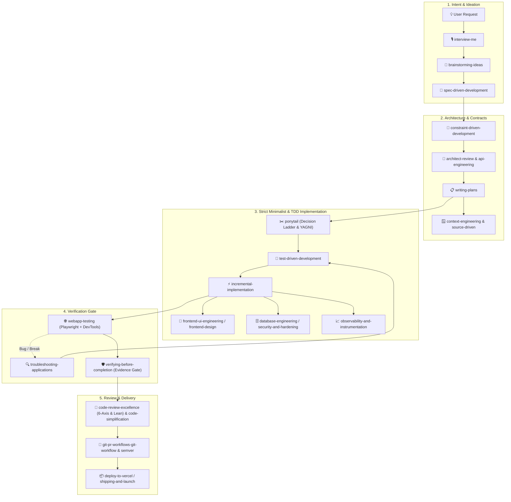

# Skill Master 🚀

**Skill Master** is the authoritative, high-discipline repository of modular AI agent skills for Google Antigravity. It empowers coding assistants with Context-Driven Development (Conductor), strict Test-Driven Development (TDD) cycles, multi-tier automated code reviews, full-stack architecture, Git/PR delivery pipelines, Vercel & React ecosystems, and an uncompromising anti-hallucination verification gate.

It also includes the zero-dependency **Antigravity Skills Manager** CLI, allowing targeted, on-demand installation of 300+ domain skills from the Antigravity Skill Vault without context token bloat.

---

## 📜 Skill Management & Governance Directives

All agent interactions and maintenance in this repository must strictly adhere to these core rules:

### 1. The Core Commandments
1. **Never Duplicate or Create Thematically Identical Skills**:
   - If a skill covers similar ground or shares a theme with an existing one, **never create a duplicate directory or redundant skill**.
   - **Evolve and update the existing skill** to make it better, broader, and more capable.
2. **Positive Updates Only**:
   - Every modification must be a positive enhancement: adding sharper triggers, deeper checklists, structural remedies, or missing edge cases. Never degrade, bloat, or strip existing strengths.
3. **Synthesize & Merge Overlapping Skills**:
   - When discovering skills with related capabilities (e.g. from external repositories or workspaces), consolidate them into a single authoritative master skill.
4. **Mandatory Synchronized Catalog Tracking**:
   - Every creation, addition, removal, merge, or evolution MUST be immediately logged in [`Catalog.md`](file:///Catalog.md).
   - Metrics, inventory tables, evolution ledgers, and changelogs must always remain 100% synchronized.
5. **Living Documentation Protocol (Dynamic Instruction Capture)**:
   - Whenever the user introduces new instructions, engineering workflows, or governance rules that are beneficial to the skills or project, **proactively update `README.md` and `Catalog.md`** so the system continuously learns and persists those directives across sessions.

---

### 2. Standard Operating Procedures (SOP)

#### A. Adding a New Skill
1. **Thematic Collision Check**: Search `.agent/skills/` and [`Catalog.md`](file:///Catalog.md) for existing skills in the same domain or theme.
2. **Collision Decision**:
   - *If thematic overlap exists*: Upgrade the existing skill instead (see SOP B).
   - *If genuinely unique*: Create `.agent/skills/<skill-name>/` with a standard `SKILL.md`.
3. **Standards**: Include valid YAML frontmatter (`name`, gerund-style `description`), progressive disclosure, and keep under `<500` lines where possible.
4. **Catalog Sync**: Add to [`Catalog.md`](file:///Catalog.md) under repository metrics, active registry table, and the latest changelog.
5. **Verification**: Run `node skills-cli.js installed` to confirm validation passes.

#### B. Updating / Evolving an Existing Skill
1. **Audit Existing Strengths**: Read the existing `SKILL.md` completely. Never discard or overwrite existing battle-tested patterns.
2. **Weave New Capabilities**: Integrate new workflows, decision trees, checklists, or error patterns cleanly into the existing structure.
3. **Update Frontmatter Triggers**: Ensure the YAML `description` reflects newly absorbed capabilities so Antigravity routes to it accurately.
4. **Log in Catalog**: Record the evolution in [`Catalog.md`](file:///Catalog.md)'s Consolidation & Evolution Ledger.

#### C. Merging Overlapping Skills
1. **Select Master Identifier**: Choose the cleanest, most concise name (e.g., `api-engineering`, `frontend-design`, `webapp-testing`).
2. **Synthesize Content**: Extract the best parts of each source skill (frameworks, scripts, schemas, checklists) into the master skill.
3. **Eliminate Redundant Directories**: Remove subsumed skill directories to maintain zero duplication.
4. **Record Lineage**: Document the merge rationale and source skills in [`Catalog.md`](file:///Catalog.md).

#### D. Removing / Deprecating a Skill
1. **Audit Dependents**: Verify no active tracks or skills depend on the skill being removed.
2. **Preserve Unique Insights**: If the skill contains valuable patterns, migrate them into a related surviving skill first.
3. **Remove & Sync**: Delete the folder and update [`Catalog.md`](file:///Catalog.md) metrics and changelog with clear rationale.

---

### 3. Global Antigravity Integration (Live Auto-Sync & Token Efficiency)

To ensure **every project on the system** automatically has access to Skill Master while keeping token consumption minimal:

```
┌──────────────────────────────────────────────┐
│       D:\Code\Skill_Master                   │
│       (Single Source of Truth)               │
│                                              │
│       .agent/skills/ [66 skills]             │
└──────────────────────┬───────────────────────┘
                       │  NTFS Directory Junction
                       │  (Instant 0ms Hardlink)
                       ▼
┌──────────────────────────────────────────────┐
│       Global Antigravity Environment         │
│       ~/.gemini/config/skills/               │
│       ~/.gemini/antigravity/skills/          │
│       ~/.gemini/config/skills.json           │
└──────────────────────────────────────────────┘
```

1. **Zero-Latency Live Auto-Sync (NTFS Directory Junction)**:
   - `C:\Users\<user>\.gemini\config\skills` is an NTFS Directory Junction linked directly to `D:\Code\Skill_Master\.agent\skills`.
   - Any skill added, edited, or deleted in `Skill_Master` is **immediately reflected everywhere** on this PC with **zero build steps or sync commands required**.
   - `skills-cli.js sync-global` is also available as a fallback snapshot copier if unlinked environments ever require it.

2. **Token Efficiency: How "Progressive Disclosure" Works**:
   - **Does having 66 skills consume huge tokens in every project?** **No.**
   - Antigravity never dumps entire skill manuals, scripts, or checklists into the context window.
   - **Level 1 (System Prompt Index)**: Antigravity only loads a compact 2-line summary per skill (YAML `name` and `description`). For 66 skills, this is only ~**3,000 tokens** total (~0.3% of a 1M token context, or ~1.5% of 200k).
   - **Level 2 (On-Demand Activation)**: The full `SKILL.md` body, checklists, reference documents, and scripts are loaded into context **only when that specific skill is actually invoked** by the agent or user.

3. **Project-Level Scoping & Filtering (When a project doesn't need all skills)**:
   - **Project-Local Precedence**: If a project defines its own `.agent/skills/` directory, project-local skills take precedence over global ones.
   - **Project Filtering**: Individual projects can define a local `.agents/skills.json` or `.agent/skills.json` to filter global skills with `include_only` or `exclude` arrays if strict isolation or zero overhead is desired.
   - **On-Demand Project Vendoring**:
     ```bash
     node D:\Code\Skill_Master\skills-cli.js install <skill-id>
     ```

4. **Disaster Recovery & Windows Reinstallation Guide**:
   - **What happens if you reinstall/format Windows ("give Windows")?**
     - **C: Drive is wiped**: Windows reinstall formats `C:\`, meaning `C:\Users\<user>\.gemini\` and its junctions will disappear.
     - **D: Drive survives**: As long as you only format the C: partition during Windows installation, `D:\Code\Skill_Master` remains completely safe and untouched on disk!
   - **1-Click Post-Install Restoration**:
     - After reinstalling Windows and installing Antigravity, open `D:\Code\Skill_Master` and double-click:
       ```bat
       setup-global.bat
       ```
     - It will automatically recreate `%USERPROFILE%\.gemini\config\skills.json`, rebuild the live NTFS Junctions, and restore all 66 master skills globally in **under 1 second**.
   - **100% Cloud Safety (GitHub)**:
     - Push `Skill_Master` to a private or public GitHub repository to protect against total SSD failure:
       ```bash
       git remote add origin https://github.com/<your-username>/Skill_Master.git
       git push -u origin master
       ```

5. **Clean Workspace Principle (Zero-Boilerplate Projects)**:
   - **Do NOT create generic `.agent/skills/` folders in project repositories**:
     - All general-purpose engineering skills (frontend, backend, testing, git, etc.) are already globally accessible from `Skill_Master`.
     - Keeping duplicate skill folders in individual projects causes version drift and prevents projects from receiving auto-updates when `Skill_Master` evolves.
   - **When to add `.agent/skills/` locally in a project**:
     - ONLY create a local `.agent/skills/` (or `.agents/skills/`) folder if writing a **strictly project-unique skill** (e.g. proprietary company APIs, specific MFS payment gateways, or custom internal tooling).
     - Everything else cleanly inherits from global `Skill_Master` with zero overhead.

---

## 🏗️ Repository Architecture

All **68 active skills** reside in `.agent/skills/`. Each skill is self-contained with its instructions, resources, and optional automation scripts:

```text
Skill_Master/
├── README.md                                 # Master repository documentation & governance rules
├── Catalog.md                                # Project catalog, status board & changelog
├── skills-cli.js                             # Zero-dependency Node.js CLI to manage skills
├── skills_cli.py                             # Standard Python CLI to manage skills
├── catalog.json                              # 307-skill catalog index
├── bundles.json                              # Curated skill bundles (core-dev, ops, security...)
├── aliases.json                              # Short command aliases for long skill IDs
└── .agent/
    └── skills/
        ├── accessible-forms-dialogs/         # WAI-ARIA forms, modal dialogs, & keyboard navigation
        ├── agent-orchestrator/               # Sub-agent orchestration with gated handoffs & verifier
        ├── algorithmic-art/                  # p5.js generative art with seeded randomness
        ├── antigravity-skills-manager/       # Meta-skill: browse & install catalog skills; lifecycle governance
        ├── api-engineering/                  # Contract-first REST/GraphQL, RFC 7807, CORS & base URLs
        ├── architect-review/                 # Architecture patterns & technical design reviews
        ├── brainstorming-ideas/              # Collaborative ideation, 7 lenses & spec creation
        ├── brand-identity/                   # Design tokens, tech stack rules, & copy guidelines
        ├── brandkit/                         # High-end brand guidelines boards & logo systems
        ├── canvas-design/                    # Visual design for PNG/PDF assets with bundled fonts
        ├── ci-cd-and-automation/             # Automated build pipelines, test runners, & CI gates
        ├── clean-code-frontend-audit/        # Zero-hardcoding matrix & whole-repo lean bloat audits
        ├── code-review-excellence/           # 6-axis review, static analysis, security, scale & lean audit
        ├── code-simplification/              # Refactor complex code for clarity without behavior change
        ├── conductor-implement/              # Execute Conductor tasks with TDD & verification patterns
        ├── conductor-manage/                 # Conductor track lifecycle (archive, restore, cleanup)
        ├── conductor-new-track/              # Initialize new feature track & task breakdown
        ├── conductor-revert/                 # Git-aware undo by track, phase, or task
        ├── conductor-setup/                  # Context-Driven Development setup & living docs
        ├── conductor-status/                 # Project status dashboard & track progress
        ├── conductor-validator/              # Validate Conductor artifacts for completeness
        ├── constraint-driven-development/    # Quality bar contracts in CONSTRAINTS.md
        ├── context-engineering/              # Context curation preventing hallucination & drift
        ├── database-engineering/             # Schema migrations, pooling, RLS for PostgreSQL/SQLite
        ├── dataviz-recharts-analytics/       # Recharts visualizations, SVG styling, & responsive containers
        ├── deploy-to-vercel/                 # Preview & production deploys via Git and Vercel CLI
        ├── deprecation-and-migration/        # Zero-downtime deprecation & expand/contract patterns
        ├── discernment-nudge/                # Probing follow-up questions to stress-test assumptions
        ├── documentation-engineering/        # 3-stage collaborative doc authoring & ADR records
        ├── docx/                             # Programmatic Word .docx creation, parsing, & templates
        ├── doubt-driven-development/         # Adversarial fresh-context review of high-stakes decisions
        ├── frontend-design/                  # Studio-tier anti-slop visual design, Bento, & fluid motion
        ├── frontend-ui-engineering/          # Production-quality, accessible, responsive UI components
        ├── full-stack-orchestration/         # Multi-layer feature delivery (frontend, API, DB)
        ├── git-advanced-workflows/           # Advanced git (rebase, worktrees, bisect, reflog)
        ├── git-pr-workflows-git-workflow/    # Trunk-based delivery, save points, semver & PR scaffolding
        ├── incremental-implementation/       # Thin vertical slices behind feature flags
        ├── internal-comms/                   # Corporate status reports, newsletters, incident reports
        ├── interview-me/                     # One-at-a-time diagnostic interview clarifying intent
        ├── mcp-builder/                      # Model Context Protocol (MCP) server development
        ├── minimalist-ui/                    # Clean editorial interfaces with warm monochrome palettes
        ├── observability-and-instrumentation/# Structured logging, RED metrics, tracing, & health alerts
        ├── pdf/                              # PDF parsing, table extraction, OCR, form-filling, & merging
        ├── performance-optimization/         # Full-stack profiling (frontend, API, DB queries)
        ├── ponytail/                         # Lazy senior dev mindset: 6-step Decision Ladder, YAGNI, debt ledger
        ├── pptx/                             # Presentation creation, slide layouts, & text extraction
        ├── redesign-existing-projects/       # Upgrade existing web interfaces to premium agency quality
        ├── security-and-hardening/           # OWASP Top 10 prevention, dependency audits, & privacy
        ├── shipping-and-launch/              # Pre-launch checklists, staged rollouts, & rollback plans
        ├── skill-creator/                    # Meta-skill: scaffolds new Antigravity skills
        ├── slack-gif-creator/                # Animated GIFs optimized for Slack constraints
        ├── source-driven-development/        # Ground implementations in official documentation citations
        ├── spec-driven-development/          # PRDs and modular capability maps before code
        ├── test-driven-development/          # Master TDD: Red-Green-Refactor with coverage gates
        ├── theme-factory/                    # 10 design themes and dynamic typography/palette styling
        ├── troubleshooting-applications/     # Stop-the-line debugging, triage trees, & root cause fixes
        ├── unit-testing-test-generate/       # Automated test suite & edge-case generation
        ├── vercel-composition-patterns/      # Scalable React compound components & render props
        ├── vercel-optimize/                  # Cost and performance optimization on Vercel deployments
        ├── vercel-react-best-practices/      # Vercel Engineering guidelines for rendering & caching
        ├── vercel-react-native-skills/       # React Native / Expo performance, animations & modules
        ├── vercel-react-view-transitions/    # Native View Transition API animations in React/Next.js
        ├── verifying-before-completion/      # Anti-hallucination evidence gate before completion
        ├── web-design-guidelines/            # UI compliance auditing against Web Interface Guidelines
        ├── webapp-testing/                   # Playwright test automation & Chrome DevTools MCP inspection
        ├── writing-guidelines/               # Prose clarity and style handbook auditing
        ├── writing-plans/                    # Bite-sized vertical implementation plans with TDD steps
        └── xlsx/                             # Spreadsheet parsing, formulas, charting, & data cleaning
```

---

## ⚡ The Agent Development Lifecycle

These skills connect into a seamless, non-redundant engineering lifecycle:



---

## 🛠️ On-Demand Skills CLI (`skills-cli.js`)

Use the zero-dependency Node.js CLI tool to explore and install from 307+ catalog skills on demand:

```bash
# 1. Search across 300+ skills by keyword, category, or tag
node skills-cli.js search kubernetes
node skills-cli.js search fastapi

# 2. Browse curated skill bundles (core-dev, security-core, ops-core, k8s-core, data-core)
node skills-cli.js bundles

# 3. Install a skill to current project (.agent/skills/)
node skills-cli.js install flutter-expert

# 4. Install a skill globally (~/.gemini/antigravity/skills/)
node skills-cli.js install rust-pro --global

# 5. List all currently installed skills in the workspace
node skills-cli.js installed
```

---

## 📋 Catalog & Tracking Ledger

See [`Catalog.md`](file:///Catalog.md) for the active status board, metrics ledger, consolidation lineage, and release changelog.
