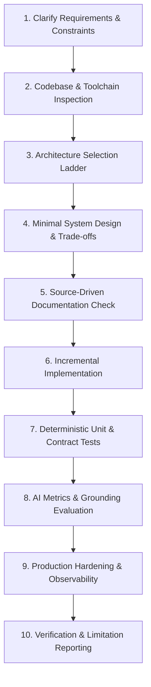

# Design Rationale: AI Application Engineering Master Skill

**Author**: Senior AI Application Architect & Agent-Skill Engineer  
**Date**: October 2026  
**Repository**: [Skill Master](https://github.com/asnayem1122/Skill_Master)  

---

## 1. Architectural Philosophy: The Power of Progressive Disclosure

When building an AI engineering skill for agentic IDEs, two major failure modes typically occur:

1. **The Monolithic Wall of Text**: Cramming 2,500 lines of documentation, code samples, and edge-case instructions into a single `SKILL.md`. This bloats the agent's context window, degrades instruction following, and increases reasoning latency.
2. **The Splintered Multi-Skill Archipelago**: Creating 8 different micro-skills (`rag-builder`, `chatbot-streamer`, `llm-evaluator`, `prompt-cacher`, etc.). This causes trigger confusion, routing failures, duplicate guidelines, and fragmented development.

### The Solution: Single Master Orchestrator + Specialized References
`ai-application-engineering` adopts the **Progressive Disclosure Pattern**:
- **`SKILL.md` (The Master Controller)**:
  - Concise (<500 lines), highly structured executive guide.
  - Contains the core 10-step engineering workflow, intake questions, architectural decision trees, and intent routing tables.
  - Instantly actionable for any agent without context pollution.
- **`references/*.md` (Specialized Deep Dives)**:
  - Deep architectural strategies, math/algorithms, concrete failure modes, and code patterns stored in modular reference files.
  - Read on-demand by the agent only when executing that specific engineering phase.

```
.agent/skills/ai-application-engineering/
├── SKILL.md                          <-- Master Controller & 10-Step Workflow
└── references/
    ├── chatbot-engineering.md        <-- Streaming, state, structured outputs, memory
    ├── rag-strategy-selection.md     <-- Retrieval ladder, hybrid RRF, reranking
    ├── document-ingestion.md         <-- Parsing, chunk boundaries, deduplication, indexing
    ├── grounding-and-quality.md      <-- Citation linking, abstention, injection defense
    ├── agent-tool-architecture.md    <-- Narrow schemas, idempotency, human confirmation
    ├── evaluation-and-metrics.md     <-- RAG Triad, G-Eval, regression suites, test goldens
    └── production-engineering.md     <-- Prompt caching, latency budgets, circuit breakers
```

---

## 2. The 10-Step Engineering Workflow

Every AI application task follows an evidence-based, 10-step lifecycle:



### Key Highlights of the 10-Step Workflow:
1. **Intake & Constraint First**: Never write an AI feature without knowing latency expectations, budget limits, data privacy constraints, and expected volume.
2. **Architecture Ladder (The Law of Minimal Complexity)**:
   $$\text{Plain LLM Call} \to \text{Structured Output} \to \text{Tool Calling} \to \text{RAG} \to \text{Autonomous Agent} \to \text{Multi-Agent Workflow}$$
   *Rule*: Always pick the lowest rung on the ladder that satisfies the requirement. Never build a multi-agent system when a single tool-calling function suffices.
3. **Evidence-Based Grounding**: LLMs must cite chunk IDs or document spans. If retrieval confidence falls below threshold, the system must gracefully abstain rather than hallucinate plausible fiction.
4. **Deterministic Gate Before LLM Evals**: Run schema validation, unit tests, and regex assertions before calling expensive LLM-as-a-judge evaluators.
5. **Production Hardening by Default**: Security rules, permissions, and financial limits must live in deterministic code outside the LLM context.

---

## 3. Technology & Framework Agnosticism

While modern AI engineering frequently uses TypeScript/Node (e.g. Vercel AI SDK, LangChain.js) and Python (e.g. FastAPI, LlamaIndex, DeepEval), `ai-application-engineering` is **strictly framework-agnostic at its core**:
- Teaches the underlying concepts: SSE stream framing, Data Stream Protocol, chunking algorithms, RRF formulas, cosine similarity, cross-encoder scoring, and NLI-based faithfulness.
- Provides clean, idiomatic TypeScript/Node and Python examples across the references where concrete implementations add clarity.
- Forbids vendor lock-in: Never assumes a specific vector database (Pinecone vs pgvector vs Qdrant vs Chroma) or a specific LLM provider (OpenAI vs Anthropic vs Google vs local Ollama). Decisions are dictated by the target project's tech stack.
